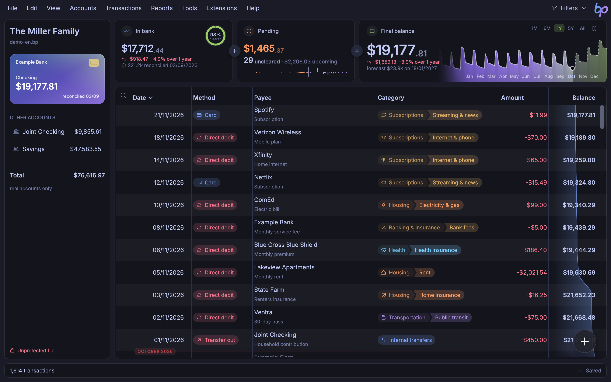
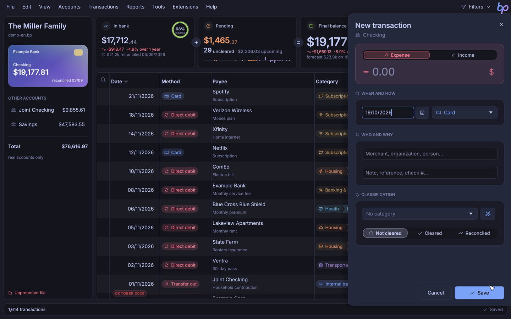
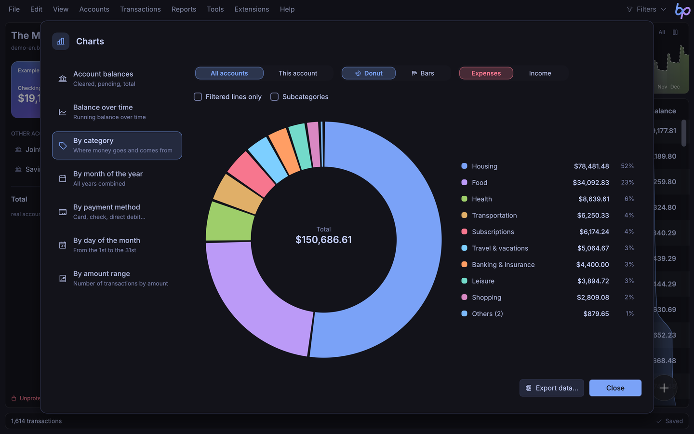
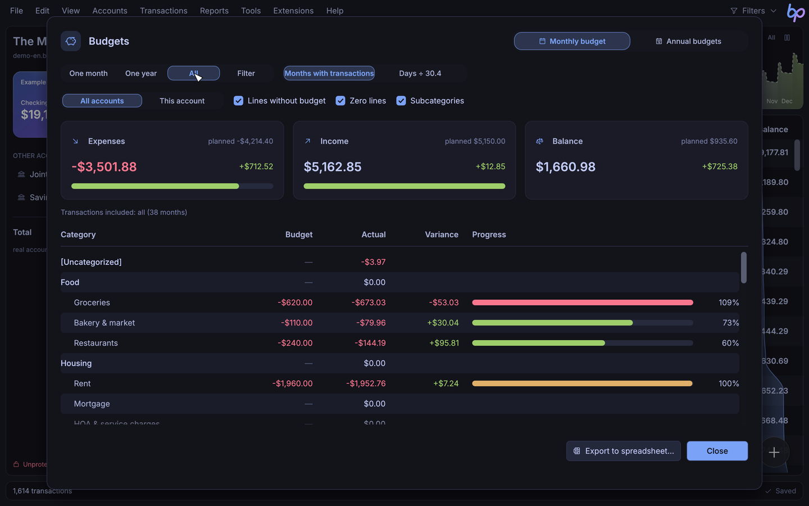
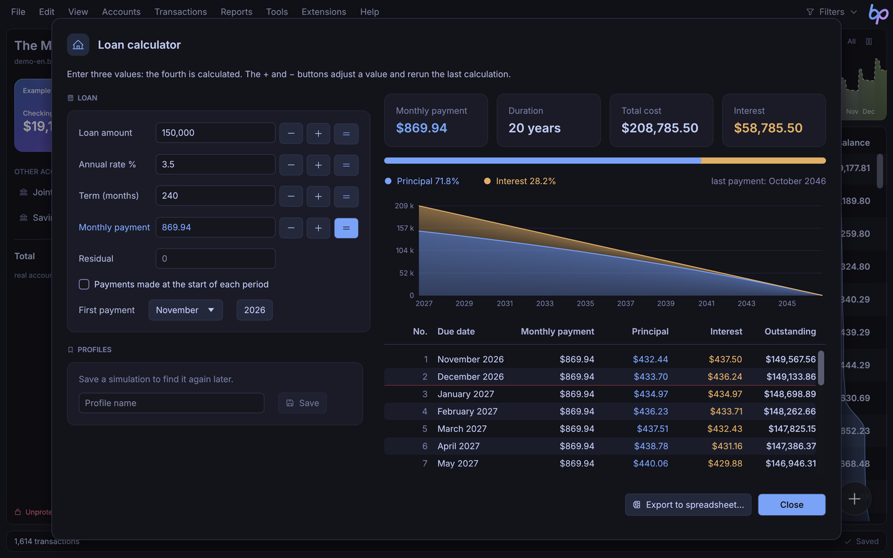
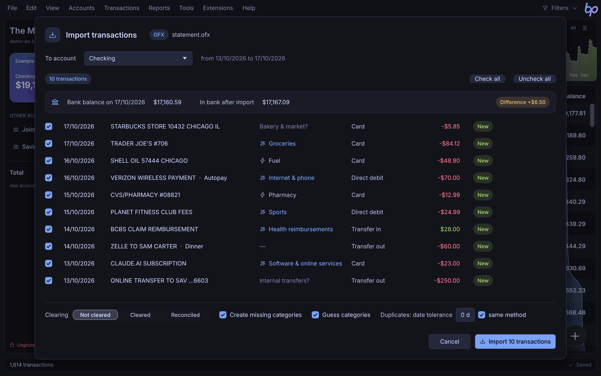
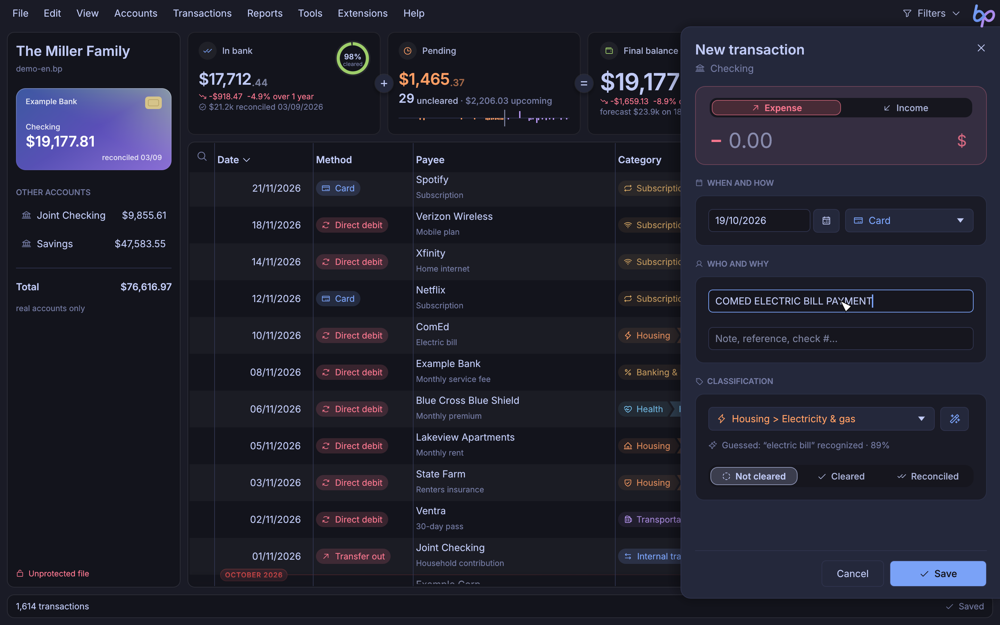

[Français](README.md) · **English**

# BankPerfect

Fast, modern personal finance software for Linux, Windows and macOS.

BankPerfect 9 is a complete Rust rewrite of BankPerfect (originally written in Delphi), with the same breadth of features, a redesigned interface and encrypted files. It opens `.bp` files from earlier versions directly.



## Features

- **Accounts and transactions**: fast entry with suggestions, color-coded payment methods, clearing and reconciliation (with clearing dates), smart clearing from the balance shown by your bank (finds the transactions that have already gone through, allowing for card and check delays), splits across several categories, linked transfers between accounts, instant search and filters, undo and redo.
- **Imports**: OFX, QIF and CSV statements, with duplicate detection and auto-categorization rules.
- **Auto-categorization**, offline: based on your past transactions (same payee, similar amount), then a built-in dictionary of more than 2,000 merchants and generic words (bakery, pharmacy, toll…) and the merchant category codes provided by bank sync. Categories are guessed on import, while you type (magic wand, F9) or in bulk for the whole file or the filtered rows (Ctrl+J), with optional help from AI (using your own Anthropic API key) for unknown descriptions.
- **Bank sync** (experimental): transactions are imported directly through [Enable Banking](https://enablebanking.com), a licensed PSD2 provider, using your own Enable Banking application (free plan for personal use). You sign in on your bank's website; your credentials are never sent to BankPerfect.
- **Scheduler**: recurring transactions inserted automatically, projected balance.
- **Reports and charts**: totals by category and by payee, multi-account statement, donut, bar and line charts, export to a spreadsheet (`.xlsx`).
- **Budgets**: monthly budget by category and yearly budget tables.
- **Tools**: loan calculator, currency converter (ECB rates), security quotes, calculator, notes, command palette (Ctrl+K).
- **Extensions**: sandboxed [Luau](https://luau.org) scripts that add commands (in the menus of their choice and on right-click), shortcuts, native windows (forms, tables, statistics, charts), statement import formats and automations for transactions, the scheduler, the budget and the rules, with built-in undo; six examples included. See the [extension documentation](docs/extensions.en.md).
- **Themes**: 19 dark and light themes (Tokyo Night, Catppuccin, Dracula, Nord, Gruvbox, Rosé Pine, One Dark, Everforest, Kanagawa, Solarized…), including “BankPerfect classic” with the colors of the previous version, and a mode that follows the system.
- **Security**: encrypted files (XChaCha20-Poly1305, password derived with Argon2id) with a 24-word recovery phrase, automatic backups.

| Entry | Charts |
| --- | --- |
|  |  |
| **Budget** | **Loan calculator** |
|  |  |
| **Categories guessed on import** | **Magic wand while typing** |
|  |  |

## Installation

Binaries are published on the [Releases](https://github.com/fabiochelly/bankperfect/releases) page.

| System | Command |
| --- | --- |
| Windows | `windows-x86_64.zip` archive from the latest release, to extract (winget package awaiting validation) |
| macOS | `brew install --cask fabiochelly/bankperfect/bankperfect` |
| Linux | `linux-x86_64.tar.gz` archive from the latest release, then `./install.sh` (AUR package coming) |

On Linux, `install.sh` installs BankPerfect for the current user (in `~/.local`) with its application menu entry, its icons and the association with `.bp` files; `./install.sh --uninstall` removes it. From the repository, after `cargo build --release`, run `packaging/linux/install.sh`.

### Windows: if BankPerfect does not open

BankPerfect 9 is still too new to be certified by Microsoft: its executable is not signed with a certificate Windows recognizes. On Windows 11, Smart App Control may then block it from opening, sometimes without any message, even as administrator.

- If Windows shows “Windows protected your PC”, click “More info” then “Run anyway”.
- If nothing opens, go to **Windows Security** > **App & browser control** > **Smart App Control settings** and choose **Off**.

This protection applies to every application, not only BankPerfect. On an up-to-date Windows 11 (24H2 or 25H2, since April 2026), you can turn it back on in the same place; on older versions, turning it back on requires reinstalling Windows.

### macOS

On macOS, installing with Homebrew removes the quarantine flag; with the archive, right-click the application and choose “Open” the first time.

## Building

Requirements: stable [Rust](https://rustup.rs) (2024 edition). On Linux, the `libxkbcommon` and `wayland` headers are required.

```sh
cargo run --release -p bankperfect
cargo test --workspace
```

The repository contains three crates:

- `crates/bp-core`: file formats (reading legacy `.bp` files, new encrypted format), data model, calculations and translations;
- `crates/bp-ext`: Luau extensions (engine, API, declarative windows);
- `crates/bp-app`: the application (egui, wgpu rendering).

`docs/inventaire/` describes the previous version feature by feature, and `docs/corrections.md` lists the bugs of the previous version fixed in the rewrite (both in French).

## License

[MIT](LICENSE) © Fabio Chelly
