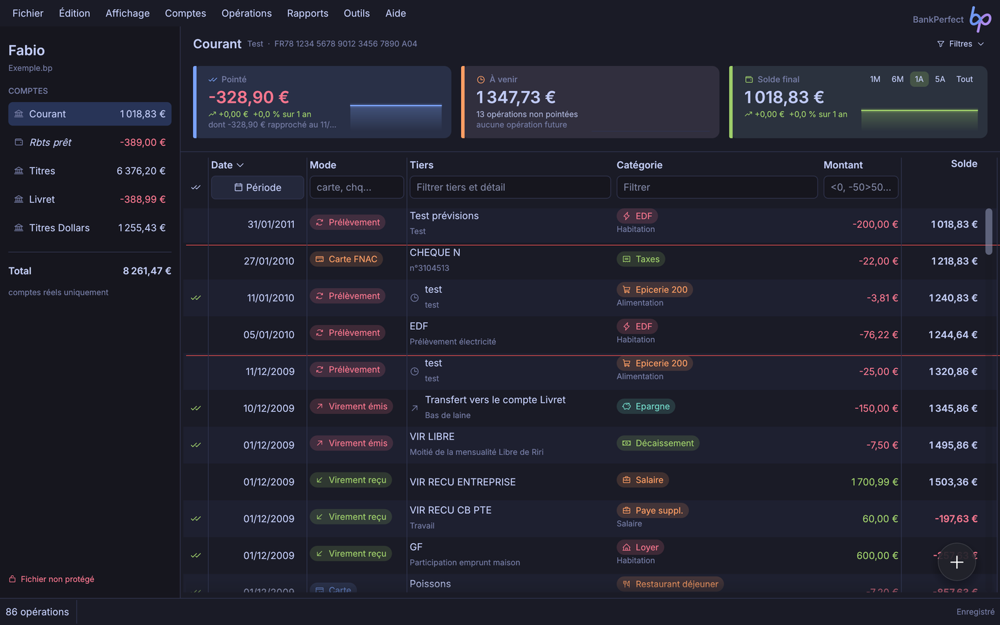
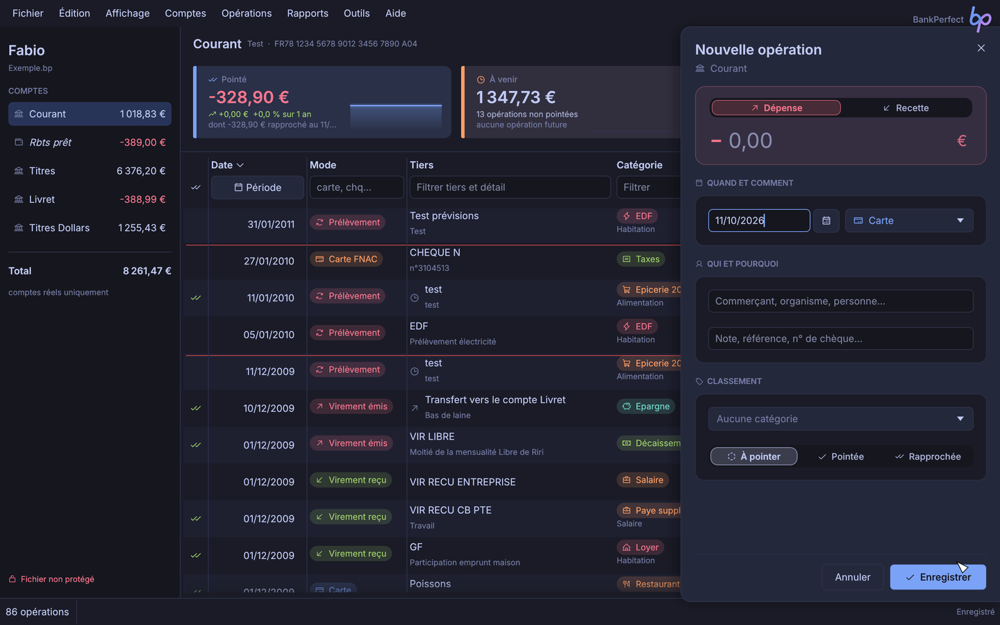
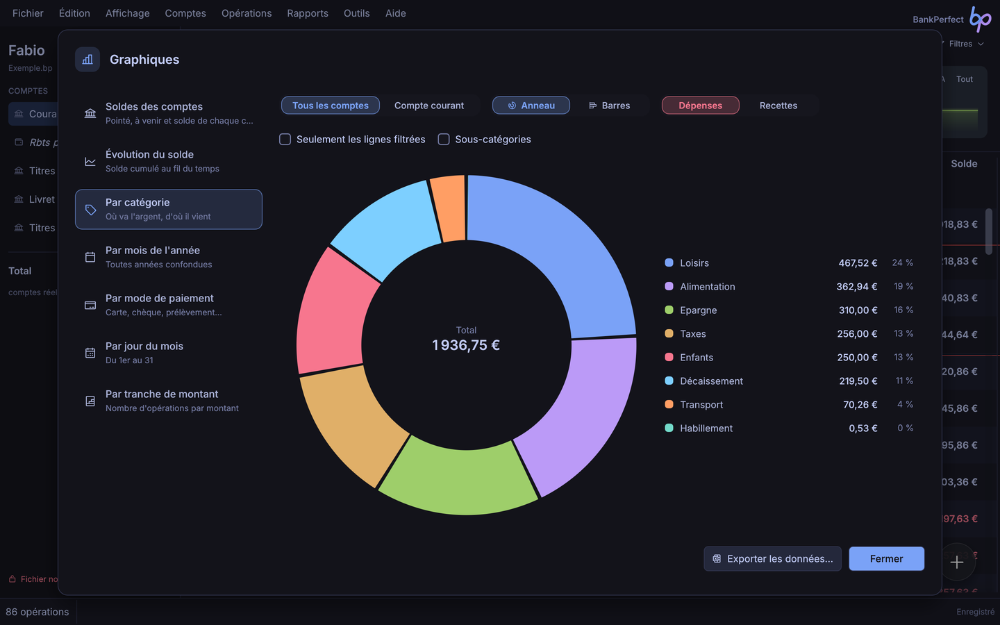
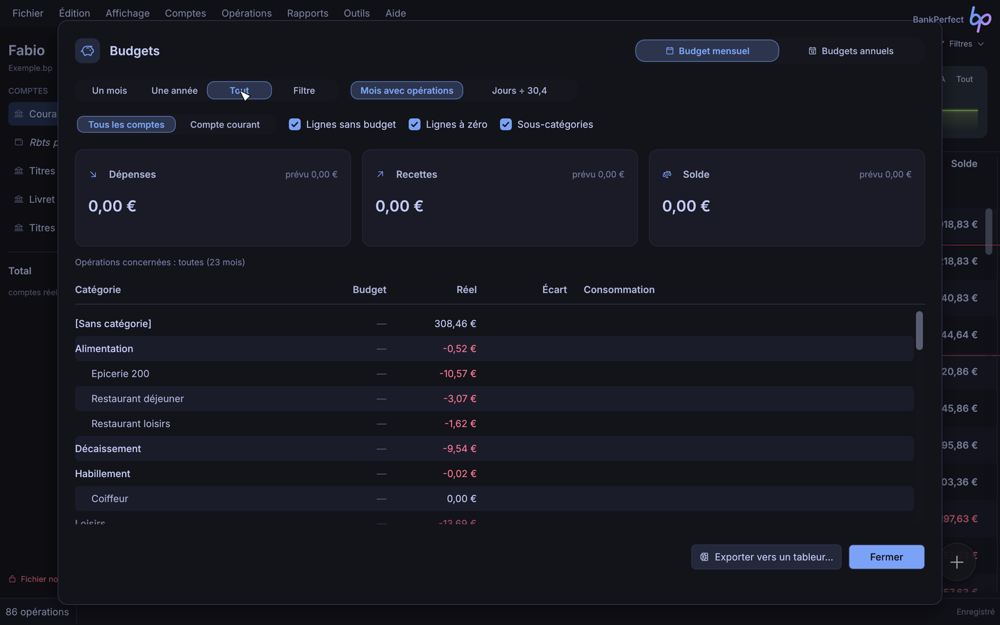
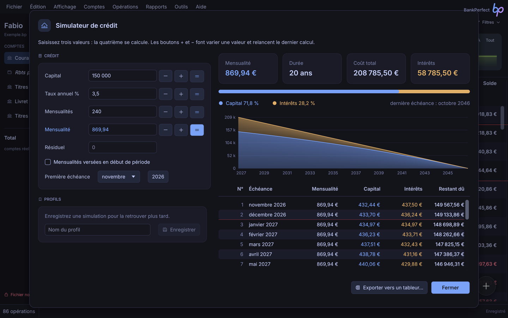
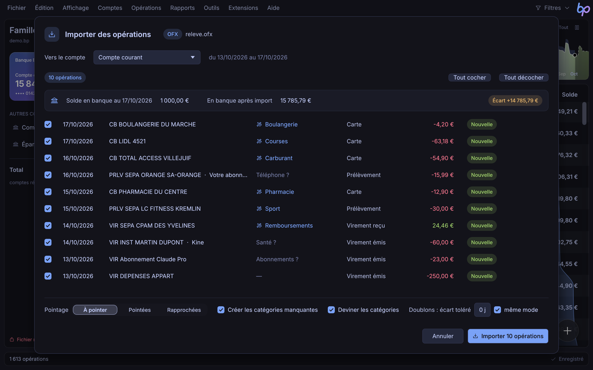
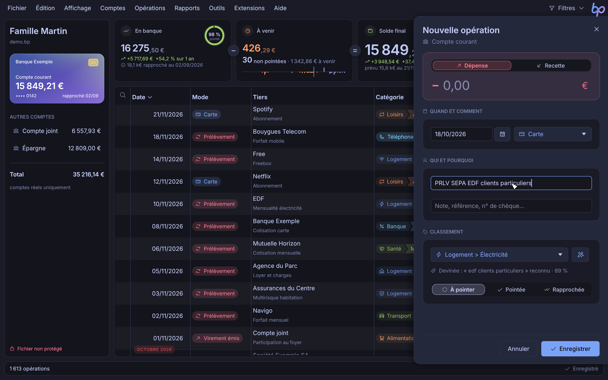

# BankPerfect

Gestion de comptes bancaires personnels, rapide et moderne, pour Linux, Windows et macOS.

BankPerfect 9 est la réécriture complète en Rust du logiciel BankPerfect (Delphi), avec la même richesse fonctionnelle, une interface repensée et des fichiers chiffrés. Il ouvre directement les fichiers `.bp` des anciennes versions.



## Fonctionnalités

- **Comptes et opérations** : saisie rapide avec suggestions, modes de paiement en couleur, pointage et rapprochement (avec dates de pointage), ventilation sur plusieurs catégories, transferts liés entre comptes, recherche et filtres instantanés, annulation et rétablissement.
- **Imports** : relevés OFX, QIF et CSV, avec détection des doublons et règles de catégorisation automatique.
- **Catégorisation automatique**, hors connexion : d'après vos opérations passées (même tiers, montant proche) puis un dictionnaire intégré d'plus de 2 000 enseignes et mots génériques (boulangerie, pharmacie, péage…) et les codes commerçant de la synchronisation. Catégories devinées à l'import, pendant la saisie (baguette magique, F9) ou en lot pour tout le fichier ou les lignes filtrées (Ctrl+J) ; recours facultatif à l'IA (votre clé d'API Anthropic) pour les libellés inconnus.
- **Synchronisation bancaire** (expérimentale) : import direct des opérations par [Enable Banking](https://enablebanking.com), prestataire agréé DSP2, avec votre propre application Enable Banking (offre gratuite pour un usage personnel) ; authentification sur le site de la banque, identifiants jamais transmis à BankPerfect.
- **Échéancier** : opérations récurrentes insérées automatiquement, solde prévisionnel.
- **Rapports et graphiques** : totaux par catégorie et par tiers, relevé multicompte, graphiques en anneau, barres et courbes, export vers un tableur (`.xlsx`).
- **Budgets** : budget mensuel par catégorie et tableaux de budget annuel.
- **Outils** : simulateur de crédit, convertisseur de devises (cours de la BCE), cotations des titres, calculatrice, notes, palette de commandes (Ctrl+K).
- **Extensions** : scripts [Luau](https://luau.org) en bac à sable qui ajoutent commandes (dans les menus de leur choix et au clic droit), raccourcis, fenêtres natives (formulaires, tableaux, statistiques, graphiques), formats d'import de relevés et automatismes sur les opérations, l'échéancier, le budget et les règles, avec annulation intégrée ; six exemples fournis. Voir la [documentation des extensions](docs/extensions.md).
- **Thèmes** : 19 thèmes sombres et clairs (Tokyo Night, Catppuccin, Dracula, Nord, Gruvbox, Rosé Pine, One Dark, Everforest, Kanagawa, Solarized…), dont « BankPerfect classic » aux couleurs de l'ancienne version, avec un mode qui suit le système.
- **Sécurité** : fichiers chiffrés (XChaCha20-Poly1305, mot de passe dérivé par Argon2id) avec clé de secours de 24 mots, sauvegardes automatiques.

| Saisie | Graphiques |
| --- | --- |
|  |  |
| **Budget** | **Simulateur de crédit** |
|  |  |
| **Catégories devinées à l'import** | **Baguette magique de la saisie** |
|  |  |

## Installation

Les binaires sont publiés sur la page [Releases](https://github.com/fabiochelly/bankperfect/releases).

| Système | Commande |
| --- | --- |
| Windows | `winget install FabioChelly.BankPerfect` |
| macOS | `brew install --cask fabiochelly/bankperfect/bankperfect` |
| Linux | archive `linux-x86_64.tar.gz` de la dernière release, puis `./install.sh` (paquet AUR à venir) |

Sous Linux, `install.sh` installe BankPerfect pour l'utilisateur (dans `~/.local`) avec son entrée dans le menu des applications, ses icônes et l'ouverture des fichiers `.bp` ; `./install.sh --uninstall` le retire. Depuis le dépôt, après `cargo build --release`, lancez `packaging/linux/install.sh`.

L'exécutable Windows est signé ([politique de signature du code](CODE_SIGNING.md)) : free code signing provided by [SignPath.io](https://signpath.io), certificate by [SignPath Foundation](https://signpath.org). Sous macOS, l'installation par Homebrew retire la mise en quarantaine ; avec l'archive, faites un clic droit sur l'application puis « Ouvrir » la première fois.

## Compilation

Prérequis : [Rust](https://rustup.rs) stable (édition 2024). Sous Linux, les en-têtes `libxkbcommon` et `wayland` sont nécessaires.

```sh
cargo run --release -p bankperfect
cargo test --workspace
```

Le dépôt contient deux crates :

- `crates/bp-core` : formats de fichiers (lecture des anciens `.bp`, nouveau format chiffré), modèle de données et calculs ;
- `crates/bp-app` : l'application (egui, rendu wgpu).

`docs/inventaire/` décrit l'ancienne version fonctionnalité par fonctionnalité, et `docs/corrections.md` liste les bogues de l'ancienne version corrigés dans la réécriture.

## Licence

[MIT](LICENSE) © Fabio Chelly
