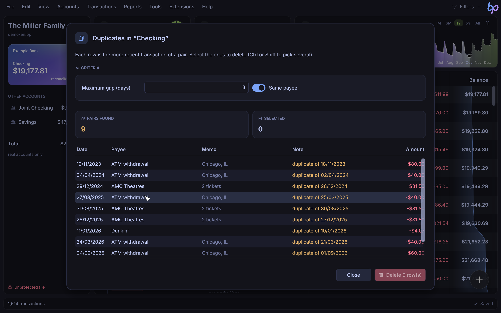
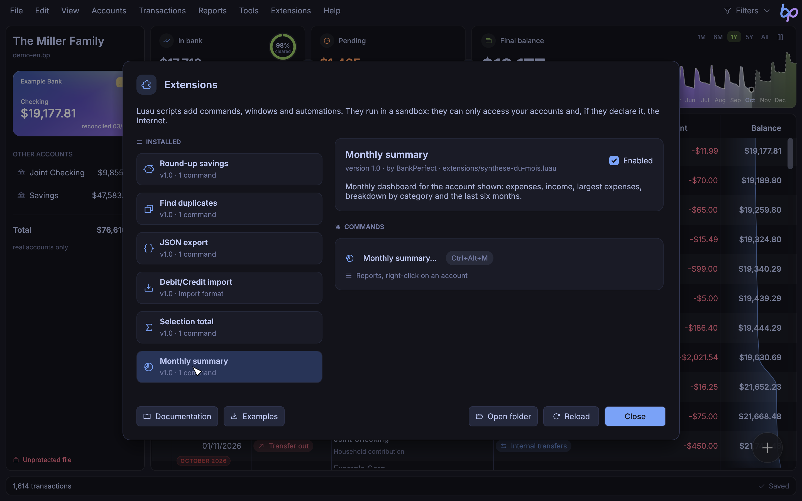
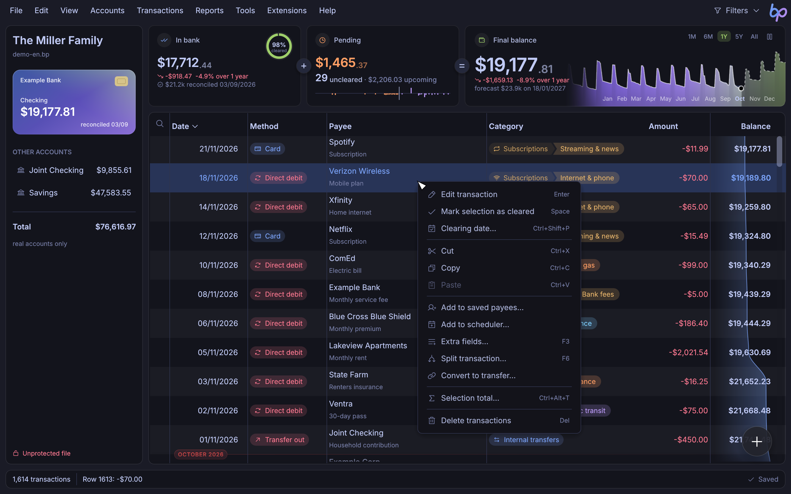
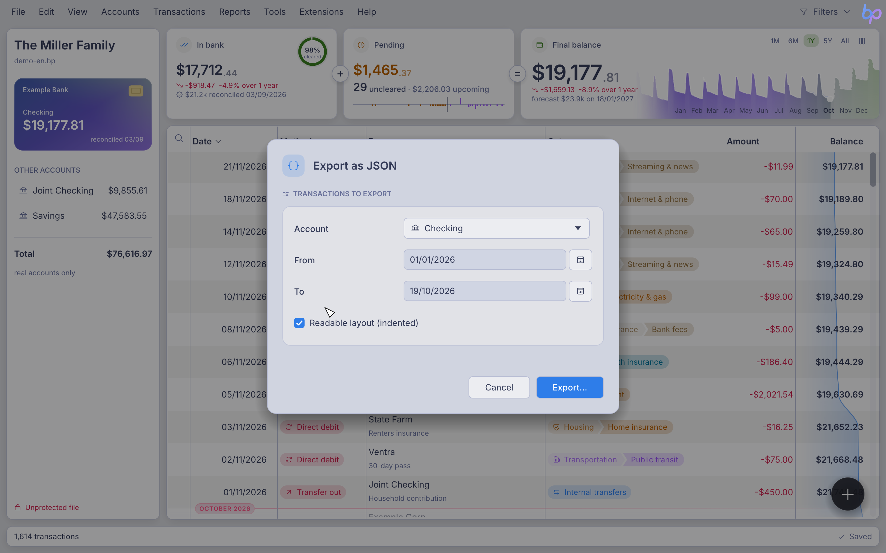
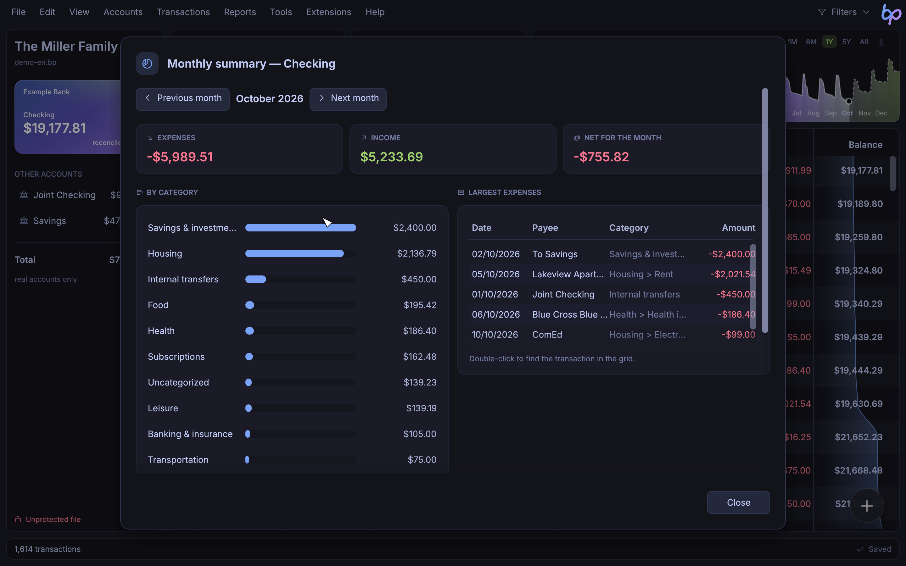
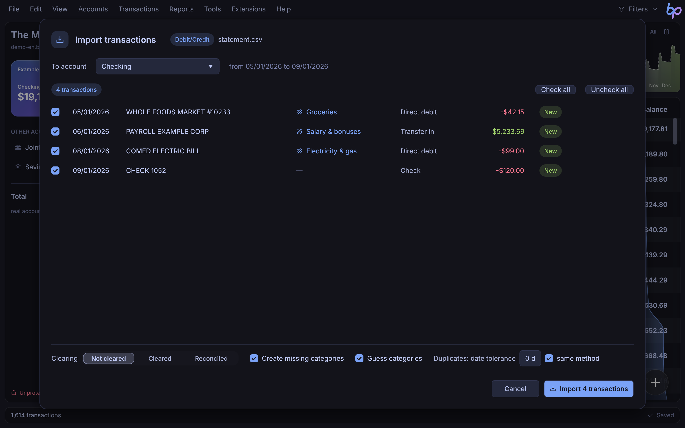

[Français](extensions.md) · **English**

# BankPerfect extensions

Extensions add commands, windows, import formats and automations to BankPerfect. They are written in [Luau](https://luau.org), a modern, fast, typed Lua (the one used by Roblox), and they are displayed with the application's own components: an extension window looks exactly like a BankPerfect window, in every theme.



- [Getting started](#getting-started)
- [Installing, enabling, reloading](#installing-enabling-reloading)
- [Structure of an extension](#structure-of-an-extension)
- [Menus](#menus)
- [Accounts and transactions](#accounts-and-transactions)
- [Dates and amounts](#dates-and-amounts)
- [Categories, payment methods, payees](#categories-payment-methods-payees)
- [Scheduler, budget, rules](#scheduler-budget-rules)
- [Grid filter](#grid-filter)
- [Dialog boxes](#dialog-boxes)
- [Windows](#windows)
- [Window elements](#window-elements)
- [Events](#events)
- [Import formats](#import-formats)
- [Storage](#storage)
- [Files, Internet, JSON](#files-internet-json)
- [Undo, errors and limits](#undo-errors-and-limits)
- [Debugging](#debugging)
- [Recipes](#recipes)
- [Security](#security)
- [Quick reference](#quick-reference)

## Getting started

Create a file named `hello.luau` in the extensions folder (menu **Extensions › Open extensions folder**):

```lua
bp.extension({
	name = "Hello",
	description = "My first extension.",
	version = "1.0",
})

bp.command({
	title = "Say hello…",
	icon = "hand-waving",
	shortcut = "Ctrl+Alt+B",
	run = function()
		local account = bp.current_account()
		bp.ui.alert(`The balance of “{account.name}” is {bp.money(account.balance)}.`)
	end,
})
```

In **Extensions › Manage extensions…**, click **Reload**: the command appears in the **Extensions** menu and in the command palette (Ctrl+K), and responds to its shortcut. To put it somewhere else (**Transactions** menu, right-click on rows…), see [Menus](#menus).

To see what is possible, click **Examples** in the same window: six commented extensions are copied into your folder.

| Example | What it shows |
| --- | --- |
| `doublons.luau` | window with criteria, multi-select table, confirmation, deletion; placed in the **Transactions** menu |
| `synthese-du-mois.luau` | statistics, bars, chart, month-by-month navigation, jumping back to the grid; placed in **Reports** and on right-click on an account |
| `selection.luau` | command acting on the selection, on right-click on transactions |
| `arrondis.luau` | reacting to new transactions, transfers, settings form, `bp.store` |
| `export-json.luau` | form with validation, `bp.json`, saving a file; placed in **File › Export** |
| `import-debit-credit.luau` | import format: CSV statements with separate Debit and Credit columns |

## Installing, enabling, reloading

An extension is either:

- a `name.luau` file;
- or a `name/` folder containing `init.luau`, and possibly other modules loaded with `require("module")` (file `module.luau` in the same folder).

The extensions folder is in the BankPerfect configuration folder: `~/.config/bankperfect/extensions` on Linux, `~/Library/Application Support/net.chelly.bankperfect/extensions` on macOS, `%APPDATA%\chelly\bankperfect\config\extensions` on Windows.



The **Manage extensions** window lists the extensions found, their commands, shortcuts and locations, their import formats, the events they listen to and the permissions they ask for. The **Enabled** checkbox turns an extension off without deleting it. A loading error is shown there, with the offending line; the **log** shows the last lines written by `print`.

After changing the code, click **Reload** (see [Debugging](#debugging)).

## Structure of an extension

### `bp.extension{ … }`

Describes the extension (optional, but recommended).

| Field | Purpose |
| --- | --- |
| `name` | displayed name (default: the file name) |
| `description` | one sentence, shown in the management window |
| `version`, `author` | displayed information |
| `permissions` | permissions: `{ "network" }` to access the Internet |
| `requires` | minimum BankPerfect version, for example `"9.1"`: on an older version, the extension does not load and the management window explains why |

### `bp.command{ … }`

Adds a command to the **Extensions** menu (or to the menus chosen with `menu`) and to the command palette. Declare it when the file loads.

| Field | Purpose |
| --- | --- |
| `title` | label (required); end it with “…” if it opens a window |
| `run` | function called (required) |
| `icon` | name of a [Phosphor](https://phosphoricons.com) icon: `"copy"`, `"piggy-bank"`, `"chart-pie-slice"`… |
| `shortcut` | shortcut: `"Ctrl+Alt+D"`, `"Ctrl+Shift+F9"`, `"F9"`. Ctrl stands for Cmd on macOS. A shortcut without Ctrl or Alt is accepted only for a function key; a shortcut already used by BankPerfect is ignored |
| `menu` | location: `"operations"`, `{ "reports", "account" }`… (see [Menus](#menus)); default `"extensions"` |
| `needs` | `"file"` (default: a file must be open), `"selection"` (rows must be selected) or `"nothing"` (works without a file) |
| `description` | help shown in the management window |
| `id` | stable identifier (default: the title) |

### `bp.importer{ … }`

Adds a file format to **File › Import transactions…**. See [Import formats](#import-formats).

### `bp.on(event, function)`

Makes the extension react to what happens in BankPerfect. See [Events](#events).

### Modules

In a folder extension, `require("tools")` loads `tools.luau` (only once) and returns what the module returns:

```lua
-- tools.luau
local M = {}
function M.monthly(amount) return amount / 12 end
return M
```

```lua
-- init.luau
local tools = require("tools")
```

## Menus

The `menu` field of `bp.command` puts the command where it is useful, instead of in the **Extensions** menu:

```lua
bp.command({
	title = "Selection total…",
	icon = "sigma",
	needs = "selection",
	menu = "grid", -- right-click on transactions
	run = function() … end,
})
```

| Location | Where |
| --- | --- |
| `"file"` | **File** menu, before **Quit** |
| `"export"` | **File › Export** submenu |
| `"edit"` | **Edit** menu |
| `"view"` | **View** menu |
| `"accounts"` | **Accounts** menu |
| `"operations"` | **Transactions** menu |
| `"reports"` | **Reports** menu |
| `"tools"` | **Tools** menu, before **Options…** |
| `"extensions"` | **Extensions** menu (default) |
| `"grid"` | right-click on transactions in the grid |
| `"account"` | right-click on an account in the accounts panel |



- A list puts the command in several places: `menu = { "reports", "account" }`.
- The **Extensions** menu only keeps the commands that are placed nowhere else (plus the extension management commands). The command palette (Ctrl+K) always offers every command.
- Extension commands are added at the end of the menu, after a separator. They are grayed out when they cannot be used (`needs`).
- With no file open, only the **File**, **Tools**, **Extensions** and **Help** menus exist, and only `needs = "nothing"` commands appear in them.
- Right-clicking a transaction that is not selected selects it first, so `bp.selection()` returns the rows concerned.
- Right-clicking an account displays it first: `bp.current_account()` is the account clicked. In a narrow window, the accounts panel is hidden and this menu is not available.

## Accounts and transactions

In the API, a transaction is called an *operation* (`operations`, `operation_added`…), the word used by BankPerfect's file format.

### Access

| Function | Returns |
| --- | --- |
| `bp.accounts()` | the accounts, in display order (`bp.accounts{ all = true }` includes disabled accounts) |
| `bp.account(name)` | the account with this name (case-insensitive), or `nil` |
| `bp.current_account()` | the account displayed |
| `bp.selection()` | the selected and displayed transactions, in grid order |
| `bp.visible()` | the displayed transactions (filters applied), in grid order |
| `bp.find(uid)` | the transaction with this identifier, across all accounts |
| `bp.file()` | `{ name, path, user }` of the open file, or `nil` |

### Account

| Field | | |
| --- | --- | --- |
| `name`, `bank`, `agency`, `number`, `iban`, `bic`, `currency` | text | writable |
| `balance` | number | balance, read-only |
| `count` | number | number of transactions |
| `disabled`, `virtual`, `current` | booleans | read-only |
| `uid` | text | account identifier |

| Method | |
| --- | --- |
| `account:operations(filter?)` | transactions, sorted by date |
| `account:add{ … }` | adds a transaction and returns it |
| `account:find(uid)` | transaction with this identifier |
| `account:balance_at(date)` | balance on a date (inclusive) |
| `account:show()` | displays this account in the grid |

The filter of `operations` accepts: `from`, `to` (inclusive dates), `payee` (text contained in the payee), `text` (in the payee or the memo), `category` (a parent category includes its subcategories; `false` = uncategorized), `mode`, `tack`, `min`, `max` (signed amounts). Text search ignores case and accents.

```lua
local groceries = account:operations({ category = "Food", from = bp.today():start_of_month() })
```

`bp.add_account{ name = "Savings", initial = 100, currency = "€" }` creates an account and returns it.

### Transaction

| Field | | |
| --- | --- | --- |
| `date` | date | writable (the clearing date follows as long as the row is not cleared) |
| `amount` | number | signed: negative for an expense |
| `payee`, `details` | text | payee and memo |
| `mode` | text | payment method: `"Carte"`, `"Prélèvement"`, `"Virement reçu"`… (see below) or a custom payment method |
| `category` | text or `nil` | full label, `"Housing > Electricity & gas"`; can be set by label, by name if it is unique, by identifier or with a category table |
| `category_id` | number or `nil` | read-only |
| `tack` | text | `"none"`, `"pointed"` (cleared) or `"reconciled"`; a change sets the clearing date to today |
| `mark_date` | date | clearing date |
| `uid` | number | identifier, read-only |
| `account` | account | read-only (see `move_to`) |
| `cheque` | text or `nil` | cheque number |
| `is_transfer` | boolean | row of a transfer between accounts |
| `split_info` | table or `nil` | row produced by a split: `{ index, count, total, payee }` (see below) |

The ten standard payment methods keep their French names in the API, whatever the interface language:

| API name | Payment method |
| --- | --- |
| `"Carte"` | card |
| `"Retrait DAB"` | ATM withdrawal |
| `"Chèque émis"` | cheque issued |
| `"Prélèvement"` | direct debit |
| `"Virement émis"` | transfer sent |
| `"TIP"` | bank payment slip |
| `"Versement"` | deposit |
| `"Dépôt de chèque"` | cheque deposit |
| `"Virement reçu"` | transfer received |
| `"Titre"` | securities |

| Method | |
| --- | --- |
| `op:field(name)` / `op:set_field(name, value)` | extra fields (F3); `nil` or `""` deletes |
| `op:fields()` | table of all extra fields |
| `op:delete()` | deletes the transaction |
| `op:move_to(account)` | moves the transaction (account or account name) |
| `op:copy_to(account)` | copies the transaction and returns the copy |
| `op:sister()` | the other row of a transfer, or `nil` |
| `op:split(parts)` | splits the transaction and returns the new rows (see below) |

Two references to the same transaction are equal (`==`); `tostring(op)` gives “date payee amount”.

### Adding

```lua
local op = bp.current_account():add({
	date = "2026-03-05",         -- or a date; default: today
	payee = "Bakery",
	details = "Bread",
	amount = -4.20,              -- required; "4.20" or "4,20" accepted
	mode = "Carte",              -- default: Carte (expense) or Virement reçu (income)
	category = "Food > Groceries",
	tack = "pointed",            -- default "none"
	fields = { ticket = 1234 },  -- extra fields
})
```

`bp.transfer{ from, to, amount, date?, details?, category? }` creates a linked transfer between two accounts and returns its two rows.

`bp.select(operations)` displays the account of the first transaction and selects the transactions of that account in the grid, at the end of the command.

### Splitting

Like **Transactions › Split transaction…** (F6), `op:split` replaces a transaction with one row per part:

```lua
local parts = op:split({
	{ amount = 80, category = "Food", details = "Groceries" },
	{ category = "Housing", details = "Home" }, -- no amount: the remainder
})
```

- Part amounts are absolute values: each row takes the sign of the original transaction. Only one part may omit its amount; it receives the remainder. The parts must add up to the original amount, otherwise the split is refused.
- The rows keep the date, payment method, clearing status and extra fields of the original; their payee becomes `[1/2] Payee` and their memo `Groceries (Total: -120.00)`.
- The original transaction no longer exists: use the rows returned.
- `row.split_info` describes a split row: `index` and `count` (“1 of 2”), `total` (original amount) and `payee` (payee without the `[1/2]` prefix).

## Dates and amounts

A date is an object:

```lua
local d = bp.date(2026, 1, 31)       -- or bp.date("2026-01-31"), bp.date("31/01/2026")
local today = bp.today()

d.day, d.month, d.year               -- 31, 1, 2026
d.weekday, d.weekday_name            -- 6, "Saturday" (1 = Monday)
d.month_name                         -- "January"
d + 30, d - 7                        -- dates
bp.date(2026, 3, 1) - d              -- 29 (days)
d:days_until("2026-03-01")           -- 29 (same calculation, with a date as text)
d < today                            -- comparisons
d:add_months(1)                      -- 28/02/2026 (stays within the month)
d:add_years(1), d:add_days(10)
d:start_of_month(), d:end_of_month(), d:start_of_year(), d:end_of_year()
d:format("mois jj, aaaa")            -- "January 31, 2026"; tokens: jj, mm, aa, aaaa, mois
d:iso()                              -- "2026-01-31"
tostring(d)                          -- "31/01/2026"
d.serial                             -- day number (BankPerfect's date format)
```

`weekday_name`, `month_name` and the `mois` token give names in the interface language. The `format` tokens are: `jj` (day), `mm` (month), `aa` (two-digit year), `aaaa` (four-digit year), `mois` (month name). `tostring(d)` always writes day first (`DD/MM/YYYY`); use `d:iso()` or `d:format(…)` for another order.

Wherever a date is expected, a text works too: `YYYY-MM-DD` (ISO) or `DD/MM/YYYY`, always day first whatever the date format of the interface (`DD/MM` and `DD` are completed with the current year and month).

Amounts are numbers (euros, or the account's currency), kept to four decimal places. Useful functions:

- `bp.money(-1234.5)` → `-€1,234.50` (`bp.money(x, "$")` for another currency), formatted like the interface;
- `bp.round(x, 2)` rounds;
- `bp.parse_amount("1,234.56 €")` → `1234.56` (or `nil`); `"1 234,56"` is accepted too.

## Categories, payment methods, payees

In the API, a payment method is called a *mode* (`mode`, `bp.modes()`).

| Function | |
| --- | --- |
| `bp.categories()` | list of `{ id, name, label, is_child, parent }` in display order |
| `bp.category(label or id)` | a category, or `nil` |
| `bp.add_category(name, parent?)` | creates the category (or returns the existing one) |
| `bp.rename_category(category, name)` | renames |
| `bp.delete_category(category)` | deletes (with its subcategories); returns the number of transactions left uncategorized |
| `bp.modes()` | list of `{ name, debit, custom }` |
| `bp.add_mode(name, debit?)` | creates a custom payment method (expense by default) |
| `bp.payees()` | memorized payees: `{ caption, payee, details, mode, category, amount }` |
| `bp.suggest_category(op)` | category guessed for a transaction or a table `{ payee, details, amount, mode }`, or `nil`: `{ category, id, confidence, sure, source, reason, alternatives }` |

`bp.suggest_category` uses the same auto-categorization as the application: the file's history first (same payee, similar amount), then the built-in merchant dictionary. `confidence` ranges from 0 to 1; `sure` is `true` above 0.8, the threshold from which the application fills in the category on its own. `source` tells where the suggestion comes from (history, description words, known merchant, merchant code, AI; in the interface language) and `reason` explains it in plain words. `alternatives` lists up to two other suggestions. The index is built on the first call and reused as long as the file does not change, so it can be called in a loop.

## Scheduler, budget, rules

These functions read and change the data of the **Scheduler**, **Monthly budget** and **Automatic rules** windows. As in those windows, a change marks the file as modified and cannot be undone with Ctrl+Z; if the command fails, the change is rolled back (like `bp.store`). Only the transactions changed by `bp.rules.apply` join the command's undo step.

### Scheduler

```lua
local rent = bp.add_schedule({
	payee = "Rent",
	amount = -850,
	mode = "Prélèvement",
	category = "Housing",
	next_date = "2026-01-05",
	every = 1, unit = "months",  -- every month
	auto = true,                 -- inserted automatically when the file opens
})

for _, s in bp.schedules() do
	print(s.index, s.payee, s.interval, s.next_date:iso())  -- 1  Rent  Every month  2026-01-05
end

bp.update_schedule(rent.index, { amount = -870, end_date = "2026-12-31" })
bp.delete_schedule(rent.index)
```

| Scheduled transaction field | |
| --- | --- |
| `index` | position in the scheduler (to pass to `update_schedule` and `delete_schedule`); it changes when an earlier scheduled transaction is deleted |
| `account`, `transfer` | account of the scheduled transaction, and linked account for a transfer (`false` removes the link) |
| `payee`, `details`, `mode`, `category`, `amount` | as for a transaction; on insertion, the sign of the amount follows the payment method |
| `next_date`, `end_date` | next and last occurrence (`end_date = false`: no end) |
| `every`, `unit` | frequency: every `every` `"days"`, `"weeks"`, `"months"` or `"years"` |
| `day` | desired day of the month (1 to 31; 31 = always the last day), or `nil` |
| `auto` | automatic insertion when the file opens |
| `postpone` | `{ saturday, sunday, holiday }`: postpone an occurrence that falls on a Saturday, a Sunday or a public holiday |
| `interval`, `finished` | frequency label (“Every 3 months”) and whether the scheduled transaction is finished, read-only |

`bp.add_schedule{ … }` creates the scheduled transaction on the displayed account, starting today, as a monthly direct debit inserted automatically, unless told otherwise (`payee` is required). `bp.update_schedule(index, { … })` only changes the fields given.

`bp.forecast(account, limit_date, { monthly = true }?)` returns the forecast of an account, like **Accounts › Forecast balance…**: rows `{ date, payee, amount, balance, kind, count }` where `kind` is `"balance"` (current balance), `"pending"` (future transaction), `"schedule"` (scheduled transaction) or `"month"` (monthly group, with `monthly`).

### Monthly budget

```lua
bp.budget.set("Food", -400)                -- planned expense per month
bp.budget.set("Income", 2500)              -- planned income
bp.budget.set("Leisure", nil)              -- removes the category from the budget
print(bp.budget.get("Food"))               -- -400

local r = bp.budget.report({ month = bp.today() })
for _, row in r.rows do
	print(row.label, row.budget, row.real, row.percent)
end
print(r.expenses.budget, r.expenses.real)
```

- Planned amounts are signed: negative for an expense, positive for income. `false` stands for uncategorized transactions.
- `bp.budget.entries()` lists the planned amounts: `{ category, amount }`.
- `bp.budget.report{ … }` computes the budget like the **Monthly budget** window. Period: `month = date` (one month), `year = 2026` (monthly average over the year) or `all = true` (average over all transactions); default: the current month. `accounts` limits it to the accounts given; `unbudgeted = true` adds the categories without a budget; `subcategories = false` rolls subcategories up into their parent. The result contains `rows` (`{ category, label, is_child, budget, real, difference, percent }`), the totals `expenses`, `income` and `total` (`{ budget, real, difference, percent }`) and `description`.

### Automatic rules

```lua
bp.rules.add({
	contains = "walmart+costco",      -- words searched for, as in the rules window
	any = true,                       -- “+” means OR
	category = "Food > Groceries",
	auto = true,                      -- applied to every new row
})

local n = bp.rules.apply()            -- active rules on the displayed rows
bp.ui.toast(`{n} transaction(s) changed`)
```

| Function | |
| --- | --- |
| `bp.rules.list()` | rules: `{ index, contains, field, active, auto, condition, actions }` (`condition` and `actions`: text of the window's columns) |
| `bp.rules.add{ … }` | adds a rule at the end and returns its position |
| `bp.rules.remove(index)` | deletes a rule |
| `bp.rules.apply(operations?)` | applies the active rules to the transactions given (default: those displayed in the grid); returns the number of transactions changed. Locked reconciled rows are skipped |

Fields of `bp.rules.add`: `contains` (required: words, `a+b`, `!excluded`, or a formula starting with `=`), `field` (`"payee"`, `"details"` or `"both"`), `any`, and the changes to make: `payee`, `details` (text or formula), `date`, `mode` (standard payment methods only), `category` (`false` removes the category), `only_uncategorized`. `active` defaults to `true` and `auto` to `false`. A malformed rule is refused with the rules window's message.

## Grid filter

```lua
bp.filter({ payee = "electric", tack = "none", from = bp.today():start_of_year() })
bp.filter(false)                -- removes the filter
local f = bp.filter()           -- current filter: { payee, mode, category, amount, tack, from, to, active }
```

Criteria are written as in the filter boxes above the grid: `payee` (payee, memo and extra fields), `mode`, `category`, `amount` (for example `"<0"` or `"-50>50"`), `from` and `to` (dates), `tack` (`"none"`, `"pointed"` = cleared, `"reconciled"`, `"marked"` = cleared or reconciled, `"all"`). In texts, words separated by spaces must all be present; `a|b` means one or the other, `/word` excludes a word, `"a phrase"` searches for the whole phrase, `=text` requires an exact match and `//` stands for an empty field. Case and accents are ignored. A new filter replaces all the criteria; the **Hide unneeded rows** option is kept. The filter is applied at the end of the command: during the command, `bp.visible()` still returns the rows displayed at the start.

## Dialog boxes

Dialog boxes wait for the user's answer, like an ordinary function: the code resumes on the next line once the user has answered.

```lua
bp.ui.alert("Import complete.", { title = "Import" })

if bp.ui.confirm("Delete 3 rows?", { ok = "Delete", danger = true }) then
	-- …
end

local name = bp.ui.prompt("Account name", { default = "Savings", placeholder = "Name" })
if name then
	-- nil if the user cancels
end

bp.ui.toast("Done")  -- unobtrusive message at the bottom of the window, without waiting
```

### Form

`bp.ui.form` displays an input window and returns the values, or `nil` if the user cancels:



```lua
local v = bp.ui.form({
	title = "Export to JSON",
	icon = "brackets-curly",
	section = "Transactions to export",   -- card title (optional)
	ok = "Export…",
	bp.ui.account({ "account", label = "Account", value = bp.current_account() }),
	bp.ui.date({ "from", label = "From", value = bp.today():start_of_year() }),
	bp.ui.date({ "to", label = "To", value = bp.today() }),
	bp.ui.checkbox({ "pretty", label = "Readable formatting", value = true }),
	validate = function(v)
		if v.to < v.from then return "Invalid period." end
		return nil
	end,
})
if v then
	print(v.account.name, v.from, v.to, v.pretty)
end
```

`validate` receives the values and returns a message to refuse them (shown in the window), or `nil`.

## Windows

For a real window (live preview, tables, buttons that act without closing…), use `bp.ui.window`. The window keeps a **state** (`state`); its **`view(state)`** function returns the list of elements to display. Fields are bound to a key of the state: when the user types or chooses, the state is updated and `view` is called again. Handlers (`on_click`…) change the state or the file, and the window redraws itself.

```lua
local ui = bp.ui

local result = ui.window({
	title = "Large expenses",
	icon = "receipt",
	size = "medium",                -- "small", "medium", "large" or a fraction of the screen (0.6)
	subtitle = "Transactions of the displayed account above a threshold.",
	state = { threshold = 100, chosen = {} },
	view = function(s)
		local rows = {}
		for _, op in bp.current_account():operations({ max = -(s.threshold or 0) }) do
			table.insert(rows, { op.date, op.payee, ui.money(op.amount), id = op })
		end
		return {
			ui.section({
				title = "Criterion",
				icon = "sliders-horizontal",
				ui.amount({ "threshold", label = "Threshold" }),
			}),
			ui.table({
				columns = { { "Date", width = 100 }, "Payee", { "Amount", align = "right" } },
				rows = rows,
				select = "chosen",
				multiple = true,
			}),
			#s.chosen > 0 and ui.text(#s.chosen .. " row(s) chosen"),
		}
	end,
	buttons = function(s)
		return {
			ui.button({ "Cancel", cancel = true }),
			ui.button({ "Clear", icon = "check", on_click = function(st)
				for _, op in st.chosen do
					op.tack = "pointed"
				end
			end }),
			ui.button({ "OK", primary = true, close = true }),
		}
	end,
})
-- result: the state (close button), or nil (Cancel, Esc)
```

Useful rules:

- a `nil` or `false` element in the list is ignored: `condition and ui.text("…")` displays an element depending on the state;
- `buttons` is a list or a function of the state; buttons are right-aligned, the last one at the far right; without buttons, the window has a **Close** button;
- a handler receives `(state, win)`; `win:close(value)` closes the window, and `bp.ui.window` then returns that value;
- a `close = true` button closes the window and returns the state, after its `on_click` if any (which can return `false` to prevent closing, or another value to return instead); `cancel = true` closes and returns `nil`; so does Esc;
- `on_change = function(state, key, win)` is called after every change to a field;
- a handler can open a dialog box or another window;
- `view` must only describe the window: it cannot open a dialog box.

## Window elements

All elements are built by `bp.ui` (here `ui`). Containers receive their children after their options.

### Layout

| Element | |
| --- | --- |
| `ui.section{ title, icon, … }` | card with a title in small caps (without `title`: plain card) |
| `ui.row{ …, align = "right" }` | elements side by side, sharing the width |
| `ui.columns{ … }` | columns of equal width (often sections) |
| `ui.separator()`, `ui.space(px)` | separator, spacing |

### Text and values

| Element | |
| --- | --- |
| `ui.text(text, { style, color, align })` | `style`: `"muted"`, `"strong"`, `"heading"`, `"small"`, `"mono"` |
| `ui.heading(text)`, `ui.muted(text)`, `ui.strong(text)` | shortcuts |
| `ui.money(amount, { currency, colored })` | formatted amount, red or green depending on the sign |
| `ui.stat{ label, value, icon, color, hint }` | key figure in a card; `value` can be a `ui.money` |
| `ui.pill(text, color)` | pill |
| `ui.notice(text, { color, icon })` | information or warning box |
| `ui.progress(fraction, { text, color })` | progress bar (0 to 1) |
| `ui.bars{ data = { { label, value, text?, color? }, … }, currency }` | proportional horizontal bars |

Colors: `"accent"`, `"positive"`, `"negative"`, `"warning"`, `"muted"` (they follow the theme) or `"#RRGGBB"`.

### Charts

`ui.chart` draws a chart like those of **Reports › Charts…**, in the theme's colors, with a legend, axis labels and tooltips on hover:



```lua
-- Several series: one label per point, one list of values per series.
ui.chart({
	style = "columns",
	labels = { "Jan", "Feb", "Mar" },
	series = {
		{ name = "Expenses", values = { 1250, 980, 1100 } },
		{ name = "Income", values = { 2100, 2100, 2350 } },
	},
	height = 240,
})

-- A single series: { label, value } pairs.
ui.chart({ style = "donut", data = { { "Housing", 850 }, { "Groceries", 420 }, { "Leisure", 130 } } })
```

| Field | |
| --- | --- |
| `style` | `"columns"` (grouped columns, default), `"bars"` (horizontal bars), `"line"` (line of the first series), `"donut"` (donut of the first series' values, as absolute values) |
| `labels`, `series` | several series: `series = { { name, values }, … }` |
| `data`, `name` | a single series: `{ { label, value }, … }` or `{ { label = …, value = … }, … }` |
| `unit` | `"amount"` (amounts, default) or `"count"` (plain numbers) |
| `currency` | currency of the amounts (default `"€"`) |
| `height` | height in points (default 260) |

### Fields

The first item is the state key; `label` puts a label on the left, `hint` a help text below, `placeholder` a placeholder text; `disabled = true` grays out the field; `value` gives the initial value in `bp.ui.form`.

| Element | Value in the state |
| --- | --- |
| `ui.input{ "key" }`, `ui.password{…}`, `ui.textarea{…}` | text |
| `ui.number{ "key", decimals = 0 }` | number (comma or period accepted) |
| `ui.amount{ "key" }` | amount |
| `ui.date{ "key" }` | date (with a calendar) |
| `ui.checkbox{ "key", label }`, `ui.switch{ "key", label }` | boolean |
| `ui.select{ "key", options }` | value of the chosen option (drop-down list) |
| `ui.choice{ "key", options }` | value of the chosen option (segmented buttons) |
| `ui.account{ "key" }` | account |
| `ui.category{ "key" }` | category label, with the application's icons and colors |
| `ui.mode{ "key" }` | payment method name |

Options are written `{ "a", "b" }` or `{ { value, "Label" }, … }` (or `{ value = …, label = …, icon = … }`).

As long as a typed number, amount or date is not valid, the state keeps the previous value and the field shows the problem.

### Buttons

`ui.button{ "Label", on_click, icon, primary, danger, style = "link", enabled, close, cancel }`, in the body or in `buttons`.

### Tables

```lua
ui.table({
	columns = { { "Date", width = 100 }, "Payee", { "Amount", align = "right", width = 120 } },
	rows = {
		{ op.date, op.payee, ui.money(op.amount), id = op },
		{ "…", ui.cell("overdue", { color = "warning", icon = "clock" }), 12 },
	},
	select = "chosen",      -- state key: id of the chosen row
	multiple = true,        -- list of ids (Ctrl and Shift to select several rows)
	on_select = function(state, value, win) end,
	on_activate = function(state, id, win) end,   -- double-click
	height = 300,
	empty = "No rows",
})
```

A cell is a text, a number, a date, `ui.money(…)` or `ui.cell(text, { color, bold, align, icon })`. A row's `id` is what the selection returns: a transaction, a text, a number… (default: the row number). Long tables stay smooth: only the visible rows are drawn.

## Events

```lua
bp.on("operation_added", function(op)
	if op.payee:lower():find("walmart") and op.category == nil then
		op.category = "Food > Groceries"
	end
end)

bp.on("operation_changed", function(op, before)
	if op.amount ~= before.amount then
		print(`{op.payee}: {before.amount} → {op.amount}`)
	end
end)
```

| Event | When | Arguments |
| --- | --- | --- |
| `"operation_added"` | a transaction is added by the user: entry, import, paste, split, transfer… | the transaction |
| `"operation_changed"` | a transaction is changed by the user: entry form, clearing, bulk edit, replace, rules… | the transaction, and a copy of its previous state |
| `"operation_deleted"` | a transaction is deleted by the user | a copy of the deleted transaction |
| `"account_selected"` | another account is displayed | the account |
| `"selection_changed"` | the grid selection changes | — (read `bp.selection()`) |
| `"file_opened"` | a file has just been opened | — |
| `"before_save"` | just before saving | — |
| `"after_save"` | after a successful save | — |

- Transaction events cover every user action that can be undone with Ctrl+Z. The function is called once per transaction (importing 200 rows makes 200 calls).
- Copies (`before`, deleted transaction) are plain tables with the same fields as a read-only transaction: `uid`, `account`, `date`, `mark_date`, `payee`, `details`, `amount`, `mode`, `category`, `category_id`, `tack`, `cheque`, `is_transfer` and `fields` (extra fields).
- Changes made in reaction to a transaction event join the undo step of the action: a single Ctrl+Z undoes the entry and what the extension added to it.
- No event is fired for: transactions created or changed by extensions, Undo and Redo, and scheduled transactions inserted automatically when the file opens.
- `selection_changed` can be very frequent (every click, every arrow key): keep the function light.

## Import formats

An extension can teach BankPerfect to read a bank's statement. The extension reads the file; the preview, duplicate detection and choice of account and categories are those of **File › Import transactions…**:



```lua
bp.importer({
	name = "My Bank",
	extensions = { "csv" },
	-- Recognizes the file (optional but strongly recommended).
	detect = function(file)
		return file.text:find("^Date;Description;Amount") ~= nil
	end,
	-- Returns the transactions read.
	parse = function(file)
		local operations = {}
		for line in file.text:gmatch("[^\r\n]+") do
			local date, label, amount = line:match("^(.-);(.-);(.-)$")
			if date ~= "Date" then
				table.insert(operations, { date = date, payee = label, amount = amount })
			end
		end
		return operations
	end,
})
```

- **Choosing the format.** When a file is imported (menu or drag and drop), BankPerfect tries the formats of the extensions whose `extensions` list contains the file's extension (case-insensitive), in alphabetical order of the extensions: the first one whose `detect` returns `true` reads the file. Without `detect`, the file extension is enough: for `csv` or `txt`, always provide a `detect`, otherwise every such file would go through your format. If no format recognizes the file, BankPerfect's own import (OFX, QIF, CSV) takes over.
- **The file**: `file.name`, `file.path`, `file.text` (decoded as UTF-8, otherwise as Windows-1252) and `file.data` (raw content, for a binary format).
- **What `parse` returns**: a list of transactions; or an account `{ name, number, bank, branch, currency, operations }`, whose number is used to find the destination account; or several accounts `{ accounts = { … } }`.
- **A transaction**: `date` and `amount` (required; numbers or texts such as `"12.50"` or `"12,50"`), `payee`, `details`, `mode` (otherwise guessed from the payee and memo, using French bank abbreviations: CB, PRLV, CHQ, VIR…), `category` (`"Parent > Child"`, created if the preview option is checked), `tack`, `cheque`, `value_date`, `id` (the bank's identifier, which helps spot duplicates).
- A transaction with no readable date or amount, or with a zero amount, is reported in the preview (**Show rejected rows**) instead of stopping the import.
- `parse` only reads: it can neither change the accounts (the import is then refused) nor open a dialog box.

The `import-debit-credit.luau` example is a complete template to adapt.

## Storage

| | Where | For |
| --- | --- | --- |
| `bp.store.get(key)` / `bp.store.set(key, value)` | in the accounts file (encrypted with it) | settings tied to the accounts, extension data |
| `bp.prefs.get(key)` / `bp.prefs.set(key, value)` | in the user's configuration | personal preferences, shared by all files |

Values are texts, numbers, booleans, tables (lists or dictionaries) and dates (stored as text). `set(key, nil)` erases. Accounts and transactions cannot be stored: keep their name or their `uid`.

Each extension has its own area in the file, out of reach of the others; it is tied to the name of the extension's file or folder (renaming it starts again from scratch). Writing to `bp.store` marks the file as modified; it is saved with the file (Ctrl+S) and cannot be undone with Ctrl+Z. If the command fails, the writes made since the last dialog box are rolled back, like the transactions. `bp.prefs` is written to disk immediately and is never rolled back.

## Files, Internet, JSON

```lua
local f = bp.files.open({ title = "Statement", filters = { CSV = { "csv", "txt" } } })
if f then
	for line in f.text:gmatch("[^\r\n]+") do
		-- f.name, f.path; the text is decoded (UTF-8, otherwise Windows-1252)
	end
end

local path = bp.files.save({ title = "Export", name = "export.csv", text = content, filters = { CSV = { "csv" } } })
```

Extensions can only access the files chosen by the user in these system dialogs (and the files the user imports, for an import format).

```lua
bp.extension({ name = "Rates", permissions = { "network" } })

local r = bp.http.get("https://api.example.com/rates?currency=USD", { headers = { Accept = "application/json" } })
if r.ok then
	local data = bp.json.decode(r.body)
end
-- bp.http.post(url, body, { headers = … }); r.status, r.ok, r.body
```

Without `permissions = { "network" }`, `bp.http` refuses. `bp.open_url(url)` opens a page in the browser.

`bp.json.encode(value, pretty?)` and `bp.json.decode(text)` convert between tables and JSON.

## Undo, errors and limits

- **One command = one undo step.** Everything a command changes (transactions, categories, payment methods, account information) is undone with a single Ctrl+Z, named after the command; only creating an account (`bp.add_account`) is not undone (the account stays, with its opening balance). In a window, each click on a button that changes the file is one step.
- **An error rolls back the changes** (transactions, lists, `bp.store`, scheduler, budget and rules) made since the last dialog box; the message is shown, with the file and line. Use `error("message")` to stop a command cleanly, and `pcall` to catch an error.
- **Locked reconciled rows**: if the option is on (**Transactions** menu), extensions can neither change, delete nor split these rows.
- **Time**: a call that runs for more than 20 seconds without yielding is stopped (infinite loop…).
- **Memory**: 512 MB per extension.
- Account and transaction objects are only valid for the open file.

## Debugging

- **Log.** `print(…)` (or `bp.log(…)`) writes to the extension's log, shown in the management window (last 200 lines).
- **Errors.** A loading error (syntax, refused call) is shown in the management window with the offending line, and the extension adds nothing. An error during a command or a reaction is shown in an error window, with the file and line.
- **Reload.** The **Reload** button reloads every extension: their open windows close and their variables start again from scratch. Whatever must survive goes in `bp.store` or `bp.prefs`. Disabling and re-enabling an extension also reloads it.
- **Versions.** `bp.version` gives the BankPerfect version (`"9.11.3"`); `requires` in `bp.extension` cleanly refuses a version that is too old. `bp.id` is the extension's identifier (the name of its file or folder).
- **Language.** `bp.language` is `"fr"` or `"en"`, the interface language. Extensions are reloaded when the user switches language, so the extension name, command names and texts can be chosen at load time. The bundled examples do it with a small function:

  ```lua
  local function tr(fr, en)
  	return if bp.language == "en" then en else fr
  end

  bp.extension{ name = tr("Synthèse du mois", "Monthly summary") }
  bp.command{ id = "synthese", title = tr("Synthèse du mois…", "Monthly summary…"), run = function() … end }
  ```

  Give the command an `id` (otherwise it is the title, which changes with the language), and keep whatever is saved in a single language: `bp.store` and `bp.prefs` keys, names of the standard payment methods (always French in the API).
- **Editor.** The definitions file [`bankperfect.en.d.luau`](bankperfect.en.d.luau) (comments in English; [`bankperfect.d.luau`](bankperfect.d.luau) is the same with French comments) provides autocompletion and type checking (see [Quick reference](#quick-reference)).

## Recipes

### Warn about an overdraft

```lua
bp.on("operation_added", function(op)
	local account = op.account
	if account.balance < 0 then
		bp.ui.toast(`Warning: “{account.name}” is overdrawn ({bp.money(account.balance)}).`)
	end
end)
```

### Search the web for the payee, on right-click

```lua
bp.command({
	title = "Search the web for the payee",
	icon = "magnifying-glass",
	needs = "selection",
	menu = "grid",
	run = function()
		local op = bp.selection()[1]
		local words = op.payee:gsub("[^%w]+", "+")
		bp.open_url("https://duckduckgo.com/?q=" .. words)
	end,
})
```

### Guess the categories of the selection, on right-click

```lua
bp.command({
	title = "Guess missing categories",
	icon = "magic-wand",
	needs = "selection",
	menu = "grid",
	run = function()
		local n = 0
		for _, op in bp.selection() do
			if op.category == nil then
				local guess = bp.suggest_category(op)
				if guess and guess.sure then
					op.category = guess.id
					n += 1
				end
			end
		end
		bp.ui.toast(`{n} transaction(s) categorized`)
	end,
})
```

### Show uncategorized transactions

```lua
bp.command({
	title = "Uncategorized transactions",
	icon = "funnel",
	menu = "view",
	run = function()
		bp.filter({ category = "//" }) -- “//”: empty field
	end,
})
```

### Put money aside every month

```lua
bp.command({
	title = "Create the monthly transfer to savings…",
	icon = "piggy-bank",
	menu = "accounts",
	run = function()
		local amount = bp.ui.prompt("Monthly amount", { default = "100" })
		if not amount then return end
		bp.add_schedule({
			payee = "Monthly savings",
			amount = -bp.parse_amount(amount),
			mode = "Virement émis", -- transfer sent
			transfer = "Savings",
			next_date = bp.today():add_months(1):start_of_month(),
		})
		bp.ui.toast("Scheduled transaction added to the scheduler")
	end,
})
```

## Security

Each extension runs in its own sandboxed Luau virtual machine:

- no direct access to the disk or the system (`io`, `os.execute`, loading libraries… do not exist);
- files only through the Open / Save dialogs, as chosen by the user, and the files the user imports;
- Internet only if the extension declares it, which the management window points out;
- BankPerfect's global variables (`bp`…) are read-only.

An extension has access to your accounts: only install extensions whose author you know or whose code you have read.

## Quick reference

For autocompletion and type checking in your editor, install [luau-lsp](https://github.com/JohnnyMorganz/luau-lsp) and point it to the definitions file [`bankperfect.en.d.luau`](bankperfect.en.d.luau), or [`bankperfect.d.luau`](bankperfect.d.luau) for French comments (`luau-lsp.types.definitionFiles` setting in VS Code).

```text
bp.extension{ name, description, version, author, permissions, requires }
bp.command{ title, run, icon, shortcut, menu, needs, description, id }
bp.importer{ name, extensions, detect, parse }
bp.on(event, function)

bp.accounts{ all? }   bp.account(name)   bp.current_account()   bp.add_account{ name, initial, currency }
bp.selection()   bp.visible()   bp.find(uid)   bp.select(ops)   bp.transfer{ from, to, amount, date, details, category }
op:split{ { amount, category, details }, … }   op.split_info
bp.categories()   bp.category(x)   bp.add_category(name, parent?)   bp.rename_category(c, name)   bp.delete_category(c)
bp.modes()   bp.add_mode(name, debit?)   bp.payees()   bp.suggest_category(op)   bp.file()   bp.filter{ … } | bp.filter(false) | bp.filter()

bp.schedules()   bp.add_schedule{ … }   bp.update_schedule(i, { … })   bp.delete_schedule(i)   bp.forecast(account, date, { monthly })
bp.budget.get(cat)   bp.budget.set(cat, amount)   bp.budget.entries()   bp.budget.report{ month | year | all, accounts }
bp.rules.list()   bp.rules.add{ … }   bp.rules.remove(i)   bp.rules.apply(ops?)

bp.date(y, m, d) | bp.date(text)   bp.today()   bp.is_date(x)
bp.money(x, currency?)   bp.round(x, decimals?)   bp.parse_amount(text)

bp.ui.alert(msg, opts)   bp.ui.confirm(msg, opts) → boolean   bp.ui.prompt(label, opts) → text|nil   bp.ui.toast(msg)
bp.ui.form{ … } → values|nil   bp.ui.window{ title, icon, size, subtitle, state, view, buttons, on_change } → value
ui.chart{ style, labels, series | data, unit, currency, height }

bp.store.get/set   bp.prefs.get/set   bp.json.encode/decode
bp.files.open{…}   bp.files.save{…}   bp.http.get(url, opts)   bp.http.post(url, body, opts)   bp.open_url(url)
print(…) | bp.log(…)   require("module")   bp.version   bp.id   bp.language

Menus: file  export  edit  view  accounts  operations  reports  tools  extensions  grid  account
Events: operation_added  operation_changed  operation_deleted  account_selected  selection_changed
        file_opened  before_save  after_save
```
