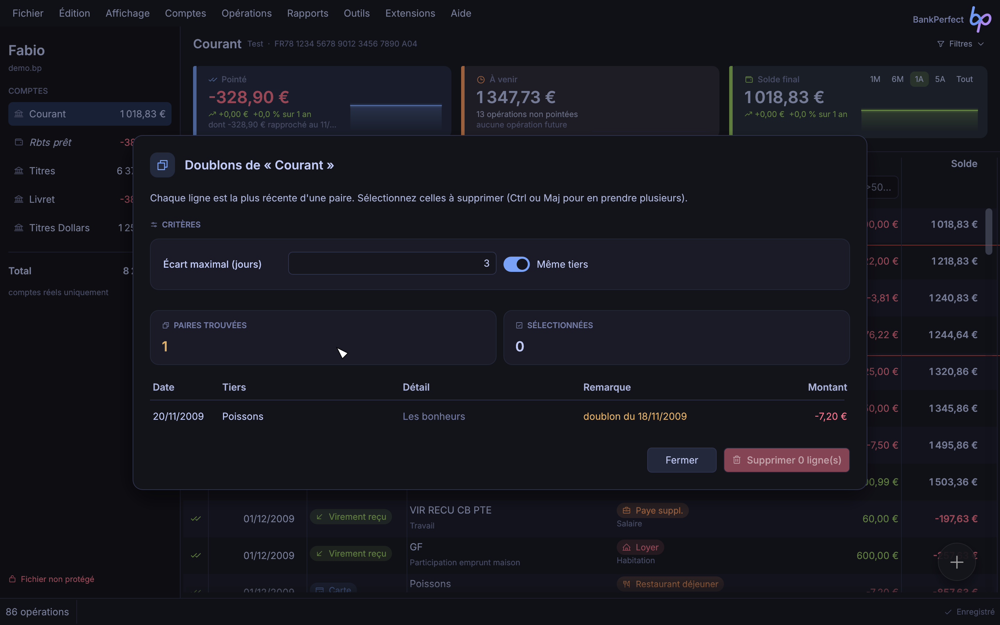
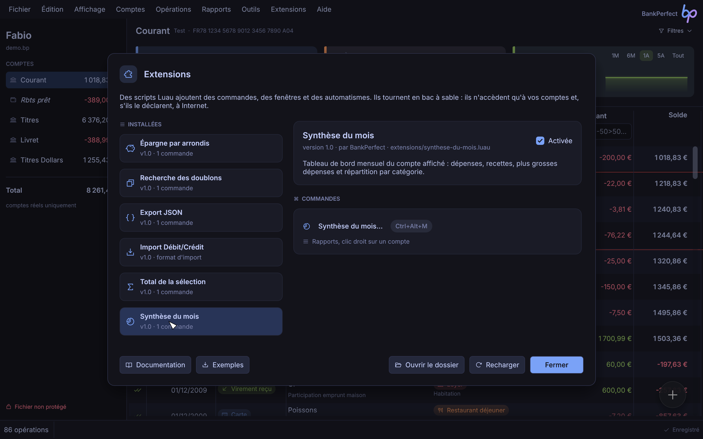
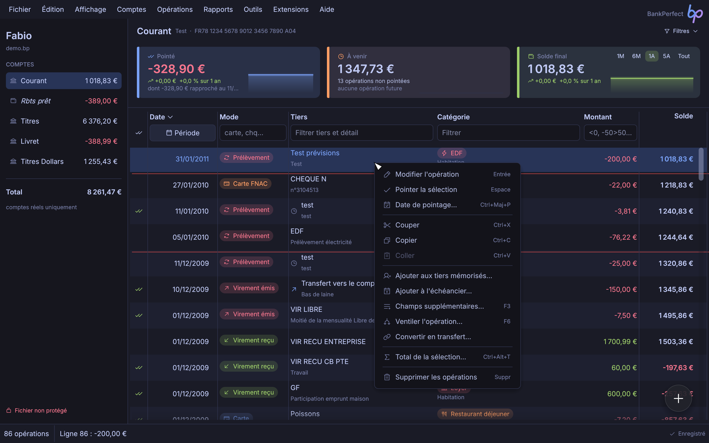
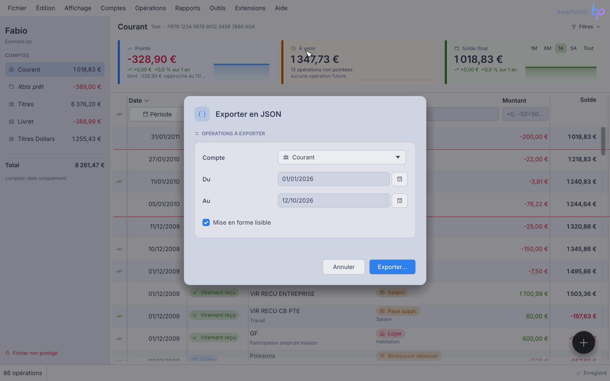
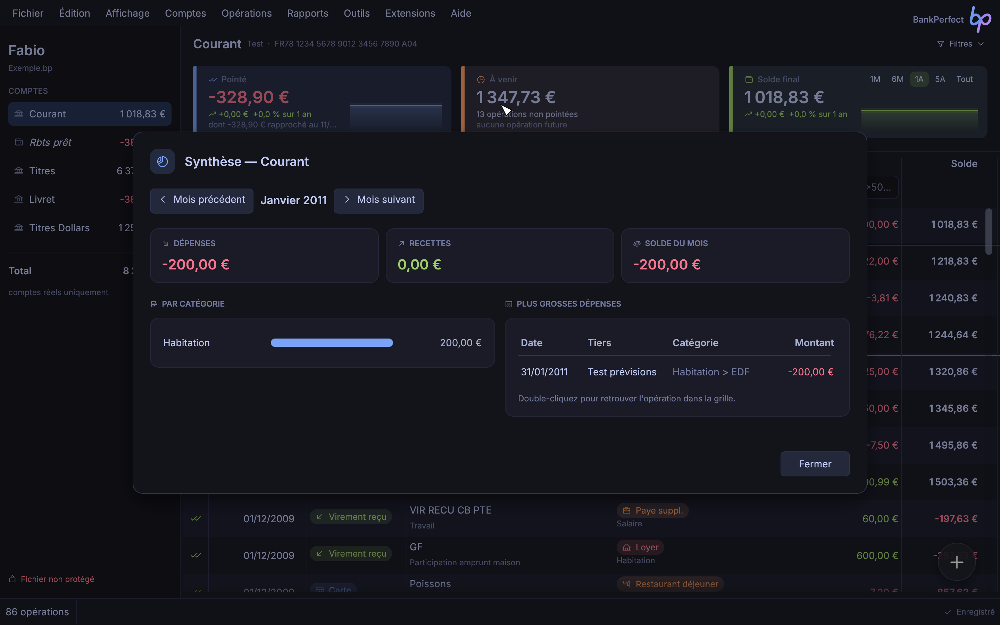
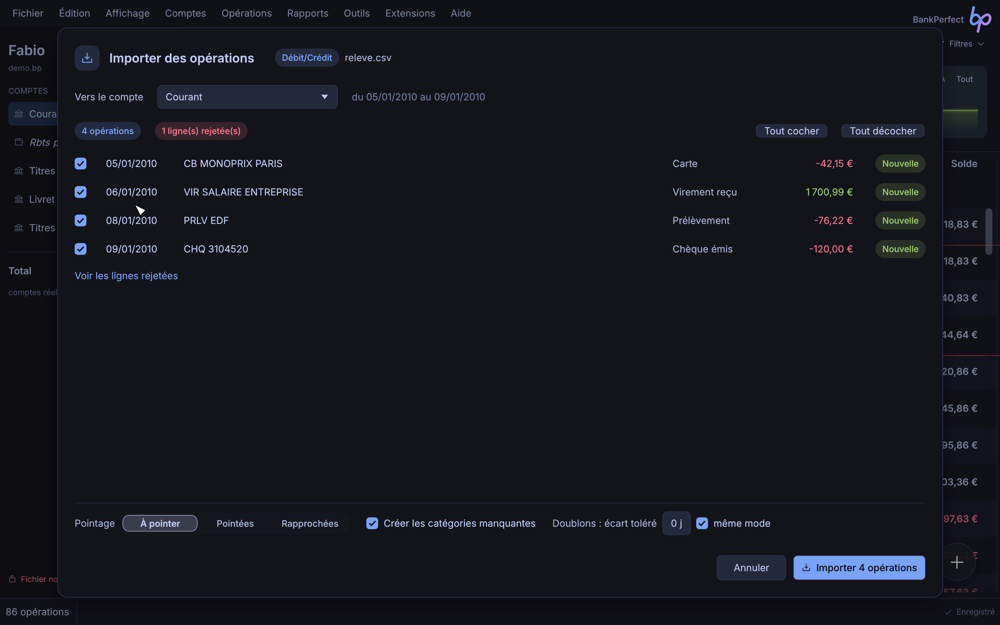

# Extensions BankPerfect

Les extensions ajoutent à BankPerfect des commandes, des fenêtres, des formats d'import et des automatismes. Elles s'écrivent en [Luau](https://luau.org), un Lua moderne, rapide et typé (celui de Roblox), et s'affichent avec les composants de l'application : une fenêtre d'extension a exactement l'allure d'une fenêtre de BankPerfect, dans tous les thèmes.



- [Premiers pas](#premiers-pas)
- [Installer, activer, recharger](#installer-activer-recharger)
- [Structure d'une extension](#structure-dune-extension)
- [Menus](#menus)
- [Comptes et opérations](#comptes-et-opérations)
- [Dates et montants](#dates-et-montants)
- [Catégories, modes, tiers](#catégories-modes-tiers)
- [Échéancier, budget, règles](#échéancier-budget-règles)
- [Filtre de la grille](#filtre-de-la-grille)
- [Boîtes de dialogue](#boîtes-de-dialogue)
- [Fenêtres](#fenêtres)
- [Éléments de fenêtre](#éléments-de-fenêtre)
- [Évènements](#évènements)
- [Formats d'import](#formats-dimport)
- [Stockage](#stockage)
- [Fichiers, Internet, JSON](#fichiers-internet-json)
- [Annulation, erreurs et limites](#annulation-erreurs-et-limites)
- [Mise au point](#mise-au-point)
- [Recettes](#recettes)
- [Sécurité](#sécurité)
- [Référence rapide](#référence-rapide)

## Premiers pas

Créez un fichier `bonjour.luau` dans le dossier des extensions (menu **Extensions › Ouvrir le dossier des extensions**) :

```lua
bp.extension({
	name = "Bonjour",
	description = "Ma première extension.",
	version = "1.0",
})

bp.command({
	title = "Dire bonjour…",
	icon = "hand-waving",
	shortcut = "Ctrl+Alt+B",
	run = function()
		local compte = bp.current_account()
		bp.ui.alert(`Le solde de « {compte.name} » est de {bp.money(compte.balance)}.`)
	end,
})
```

Dans **Extensions › Gérer les extensions…**, cliquez sur **Recharger** : la commande apparaît dans le menu **Extensions**, dans la palette de commandes (Ctrl+K) et répond à son raccourci. Pour la placer ailleurs (menu **Opérations**, clic droit sur les lignes…), voir [Menus](#menus).

Pour découvrir ce qu'il est possible de faire, cliquez sur **Exemples** dans la même fenêtre : six extensions commentées sont copiées dans votre dossier.

| Exemple | Ce qu'il montre |
| --- | --- |
| `doublons.luau` | fenêtre avec critères, tableau à sélection multiple, confirmation, suppression ; placée dans le menu **Opérations** |
| `synthese-du-mois.luau` | statistiques, barres, graphique, navigation de mois en mois, retour à la grille ; placée dans **Rapports** et au clic droit sur un compte |
| `selection.luau` | commande sur la sélection, au clic droit sur les opérations |
| `arrondis.luau` | réaction aux nouvelles opérations, transferts, formulaire de réglages, `bp.store` |
| `export-json.luau` | formulaire avec validation, `bp.json`, enregistrement d'un fichier ; placée dans **Fichier › Exporter** |
| `import-debit-credit.luau` | format d'import : relevés CSV à colonnes Débit et Crédit |

## Installer, activer, recharger

Une extension est :

- soit un fichier `nom.luau` ;
- soit un dossier `nom/` contenant `init.luau`, et éventuellement d'autres modules chargés par `require("module")` (fichier `module.luau` du même dossier).

Le dossier des extensions est celui de la configuration de BankPerfect : `~/.config/bankperfect/extensions` sous Linux, `~/Library/Application Support/net.chelly.bankperfect/extensions` sous macOS, `%APPDATA%\chelly\bankperfect\config\extensions` sous Windows.



La fenêtre **Gérer les extensions** liste les extensions trouvées, leurs commandes, raccourcis et emplacements, leurs formats d'import, les évènements qu'elles suivent et les autorisations qu'elles demandent. Une case **Activée** désactive une extension sans la supprimer. Une erreur au chargement y est affichée, avec la ligne fautive ; le **journal** montre les dernières lignes écrites par `print`.

Après une modification du code, cliquez sur **Recharger** (voir [Mise au point](#mise-au-point)).

## Structure d'une extension

### `bp.extension{ … }`

Décrit l'extension (facultatif, mais recommandé).

| Champ | Rôle |
| --- | --- |
| `name` | nom affiché (par défaut : nom du fichier) |
| `description` | une phrase, affichée dans la fenêtre de gestion |
| `version`, `author` | informations affichées |
| `permissions` | autorisations : `{ "network" }` pour accéder à Internet |
| `requires` | version minimale de BankPerfect, par exemple `"9.1"` : sur une version plus ancienne, l'extension ne se charge pas et la fenêtre de gestion l'explique |

### `bp.command{ … }`

Ajoute une commande au menu **Extensions** (ou aux menus choisis par `menu`) et à la palette. À déclarer au chargement du fichier.

| Champ | Rôle |
| --- | --- |
| `title` | libellé (obligatoire) ; terminez-le par « … » s'il ouvre une fenêtre |
| `run` | fonction appelée (obligatoire) |
| `icon` | nom d'une icône [Phosphor](https://phosphoricons.com) : `"copy"`, `"piggy-bank"`, `"chart-pie-slice"`… |
| `shortcut` | raccourci : `"Ctrl+Alt+D"`, `"Ctrl+Maj+F9"`, `"F9"`. Ctrl correspond à Cmd sous macOS. Un raccourci sans Ctrl ni Alt n'est accepté que pour une touche de fonction ; un raccourci déjà pris par BankPerfect est ignoré |
| `menu` | emplacement : `"operations"`, `{ "reports", "account" }`… (voir [Menus](#menus)) ; par défaut `"extensions"` |
| `needs` | `"file"` (par défaut : un fichier doit être ouvert), `"selection"` (des lignes doivent être sélectionnées) ou `"nothing"` (marche sans fichier) |
| `description` | aide affichée dans la fenêtre de gestion |
| `id` | identifiant stable (par défaut : le titre) |

### `bp.importer{ … }`

Ajoute un format de fichier à **Fichier › Importer**. Voir [Formats d'import](#formats-dimport).

### `bp.on(évènement, fonction)`

Fait réagir l'extension à ce qui se passe dans BankPerfect. Voir [Évènements](#évènements).

### Modules

Dans une extension en dossier, `require("outils")` charge `outils.luau` (une seule fois) et renvoie ce que le module renvoie :

```lua
-- outils.luau
local M = {}
function M.mensuel(montant) return montant / 12 end
return M
```

```lua
-- init.luau
local outils = require("outils")
```

## Menus

Le champ `menu` de `bp.command` place la commande là où elle sert, plutôt que dans le menu **Extensions** :

```lua
bp.command({
	title = "Total de la sélection…",
	icon = "sigma",
	needs = "selection",
	menu = "grid", -- clic droit sur les opérations
	run = function() … end,
})
```

| Emplacement | Où |
| --- | --- |
| `"file"` | menu **Fichier**, avant **Quitter** |
| `"export"` | sous-menu **Fichier › Exporter** |
| `"edit"` | menu **Édition** |
| `"view"` | menu **Affichage** |
| `"accounts"` | menu **Comptes** |
| `"operations"` | menu **Opérations** |
| `"reports"` | menu **Rapports** |
| `"tools"` | menu **Outils**, avant **Options** |
| `"extensions"` | menu **Extensions** (par défaut) |
| `"grid"` | clic droit sur les opérations de la grille |
| `"account"` | clic droit sur un compte du panneau des comptes |



- Une liste place la commande à plusieurs endroits : `menu = { "reports", "account" }`.
- Le menu **Extensions** ne garde que les commandes qui ne sont placées nulle part ailleurs (il reste les commandes de gestion des extensions). La palette (Ctrl+K) propose toujours toutes les commandes.
- Les commandes d'extension s'ajoutent à la fin du menu, après un séparateur. Elles sont grisées quand elles ne sont pas utilisables (`needs`).
- Sans fichier ouvert, seuls les menus **Fichier**, **Outils**, **Extensions** et **Aide** existent, et seules les commandes `needs = "nothing"` y figurent.
- Un clic droit sur une opération non sélectionnée la sélectionne d'abord ; `bp.selection()` renvoie donc les lignes concernées.
- Un clic droit sur un compte l'affiche d'abord : `bp.current_account()` est le compte cliqué. Dans une fenêtre étroite, le panneau des comptes est masqué et ce menu n'est pas disponible.

## Comptes et opérations

### Accès

| Fonction | Renvoie |
| --- | --- |
| `bp.accounts()` | les comptes, dans l'ordre d'affichage (`bp.accounts{ all = true }` inclut les comptes désactivés) |
| `bp.account(nom)` | le compte de ce nom (casse ignorée), ou `nil` |
| `bp.current_account()` | le compte affiché |
| `bp.selection()` | les opérations sélectionnées et affichées, dans l'ordre de la grille |
| `bp.visible()` | les opérations affichées (filtres compris), dans l'ordre de la grille |
| `bp.find(uid)` | l'opération de cet identifiant, tous comptes confondus |
| `bp.file()` | `{ name, path, user }` du fichier ouvert, ou `nil` |

### Compte

| Champ | | |
| --- | --- | --- |
| `name`, `bank`, `agency`, `number`, `iban`, `bic`, `currency` | texte | modifiables |
| `balance` | nombre | solde, lecture seule |
| `count` | nombre | nombre d'opérations |
| `disabled`, `virtual`, `current` | booléens | lecture seule |
| `uid` | texte | identifiant du compte |

| Méthode | |
| --- | --- |
| `compte:operations(filtre?)` | opérations, triées par date |
| `compte:add{ … }` | ajoute une opération et la renvoie |
| `compte:find(uid)` | opération de cet identifiant |
| `compte:balance_at(date)` | solde à une date (incluse) |
| `compte:show()` | affiche ce compte dans la grille |

Le filtre de `operations` accepte : `from`, `to` (dates incluses), `payee` (texte contenu dans le tiers), `text` (dans le tiers ou le détail), `category` (une catégorie mère inclut ses sous-catégories ; `false` = sans catégorie), `mode`, `tack`, `min`, `max` (montants signés). La recherche de texte ignore la casse et les accents.

```lua
local courses = compte:operations({ category = "Alimentation", from = bp.today():start_of_month() })
```

`bp.add_account{ name = "Livret A", initial = 100, currency = "€" }` crée un compte et le renvoie.

### Opération

| Champ | | |
| --- | --- | --- |
| `date` | date | modifiable (la date de pointage suit tant que la ligne n'est pas pointée) |
| `amount` | nombre | signé : négatif pour une dépense |
| `payee`, `details` | texte | tiers et détail |
| `mode` | texte | `"Carte"`, `"Prélèvement"`, `"Virement reçu"`… ou un mode personnalisé |
| `category` | texte ou `nil` | libellé complet, `"Habitation > EDF"` ; s'affecte par libellé, par nom s'il est unique, par identifiant ou par table catégorie |
| `category_id` | nombre ou `nil` | lecture seule |
| `tack` | texte | `"none"`, `"pointed"` ou `"reconciled"` ; un changement met la date de pointage au jour |
| `mark_date` | date | date de pointage |
| `uid` | nombre | identifiant, lecture seule |
| `account` | compte | lecture seule (voir `move_to`) |
| `cheque` | texte ou `nil` | numéro de chèque |
| `is_transfer` | booléen | ligne de transfert entre comptes |
| `split_info` | table ou `nil` | ligne issue d'une ventilation : `{ index, count, total, payee }` (voir plus bas) |

| Méthode | |
| --- | --- |
| `op:field(nom)` / `op:set_field(nom, valeur)` | champs supplémentaires (F3) ; `nil` ou `""` supprime |
| `op:fields()` | table de tous les champs supplémentaires |
| `op:delete()` | supprime l'opération |
| `op:move_to(compte)` | déplace l'opération (compte ou nom de compte) |
| `op:copy_to(compte)` | copie l'opération et renvoie la copie |
| `op:sister()` | l'autre ligne d'un transfert, ou `nil` |
| `op:split(parts)` | ventile l'opération et renvoie les nouvelles lignes (voir plus bas) |

Deux références à la même opération sont égales (`==`) ; `tostring(op)` donne « date tiers montant ».

### Ajouter

```lua
local op = bp.current_account():add({
	date = "05/03/2026",        -- ou une date ; par défaut aujourd'hui
	payee = "Boulangerie",
	details = "Pain",
	amount = -4.20,              -- obligatoire ; "4,20" accepté
	mode = "Carte",              -- par défaut : Carte (dépense) ou Virement reçu (recette)
	category = "Alimentation > Epicerie",
	tack = "pointed",            -- par défaut "none"
	fields = { ticket = 1234 },  -- champs supplémentaires
})
```

`bp.transfer{ from, to, amount, date?, details?, category? }` crée un transfert lié entre deux comptes et renvoie ses deux lignes.

`bp.select(opérations)` affiche le compte de la première opération et sélectionne celles de ce compte dans la grille, à la fin de la commande.

### Ventiler

Comme **Opérations › Ventiler l'opération** (F6), `op:split` remplace une opération par une ligne par part :

```lua
local parts = op:split({
	{ amount = 80, category = "Alimentation", details = "Courses" },
	{ category = "Habitation", details = "Maison" }, -- sans montant : le reste
})
```

- Les montants des parts sont en valeur absolue : chaque ligne prend le signe de l'opération d'origine. Une seule part peut omettre son montant, elle reçoit le reste. La somme des parts doit être égale au montant d'origine, sinon la ventilation est refusée.
- Les lignes gardent la date, le mode, le pointage et les champs supplémentaires de l'origine ; leur tiers devient `[1/2] Tiers` et leur détail `Courses (Total: -120,00)`.
- L'opération d'origine n'existe plus : utilisez les lignes renvoyées.
- `ligne.split_info` décrit une ligne ventilée : `index` et `count` (« 1 sur 2 »), `total` (montant d'origine) et `payee` (tiers sans le préfixe `[1/2]`).

## Dates et montants

Une date est un objet :

```lua
local d = bp.date(2026, 1, 31)       -- ou bp.date("31/01/2026"), bp.date("2026-01-31")
local aujourd_hui = bp.today()

d.day, d.month, d.year               -- 31, 1, 2026
d.weekday, d.weekday_name            -- 6, "samedi" (1 = lundi)
d.month_name                         -- "janvier"
d + 30, d - 7                        -- dates
bp.date(2026, 3, 1) - d              -- 29 (jours)
d:days_until("01/03/2026")           -- 29 (même calcul, avec une date en texte)
d < aujourd_hui                      -- comparaisons
d:add_months(1)                      -- 28/02/2026 (reste dans le mois)
d:add_years(1), d:add_days(10)
d:start_of_month(), d:end_of_month(), d:start_of_year(), d:end_of_year()
d:format("jj mois aaaa")             -- "31 janvier 2026" ; jj, mm, aa, aaaa, mois
d:iso()                              -- "2026-01-31"
tostring(d)                          -- "31/01/2026"
d.serial                             -- numéro de jour (format des dates de BankPerfect)
```

Partout où une date est attendue, un texte `jj/mm/aaaa` convient aussi (`jj/mm` et `jj` complètent avec l'année et le mois en cours).

Les montants sont des nombres (euros, ou devise du compte), gardés au dix-millième près. Utiles :

- `bp.money(-1234.5)` → `-1 234,50 €` (`bp.money(x, "$")` pour une autre devise) ;
- `bp.round(x, 2)` arrondit ;
- `bp.parse_amount("1 234,56 €")` → `1234.56` (ou `nil`).

## Catégories, modes, tiers

| Fonction | |
| --- | --- |
| `bp.categories()` | liste de `{ id, name, label, is_child, parent }` dans l'ordre d'affichage |
| `bp.category(libellé ou id)` | une catégorie, ou `nil` |
| `bp.add_category(nom, mère?)` | crée la catégorie (ou renvoie celle qui existe déjà) |
| `bp.rename_category(catégorie, nom)` | renomme |
| `bp.delete_category(catégorie)` | supprime (avec ses sous-catégories) ; renvoie le nombre d'opérations qui n'ont plus de catégorie |
| `bp.modes()` | liste de `{ name, debit, custom }` |
| `bp.add_mode(nom, dépense?)` | crée un mode personnalisé (dépense par défaut) |
| `bp.payees()` | tiers mémorisés : `{ caption, payee, details, mode, category, amount }` |

## Échéancier, budget, règles

Ces fonctions lisent et modifient les données des fenêtres **Échéancier**, **Budget mensuel** et **Règles automatiques**. Comme dans ces fenêtres, une modification marque le fichier comme modifié et ne s'annule pas avec Ctrl+Z ; si la commande échoue, elle est défaite (comme `bp.store`). Seules les opérations modifiées par `bp.rules.apply` rejoignent l'étape d'annulation de la commande.

### Échéancier

```lua
local loyer = bp.add_schedule({
	payee = "Loyer",
	amount = -850,
	mode = "Prélèvement",
	category = "Habitation",
	next_date = "05/01/2026",
	every = 1, unit = "months",  -- tous les mois
	auto = true,                 -- inséré automatiquement à l'ouverture du fichier
})

for _, e in bp.schedules() do
	print(e.index, e.payee, e.interval, e.next_date)  -- 1  Loyer  Tous les mois  05/01/2026
end

bp.update_schedule(loyer.index, { amount = -870, end_date = "31/12/2026" })
bp.delete_schedule(loyer.index)
```

| Champ d'une échéance | |
| --- | --- |
| `index` | rang dans l'échéancier (à passer à `update_schedule` et `delete_schedule`) ; il change quand une échéance précédente est supprimée |
| `account`, `transfer` | compte de l'échéance, et compte lié pour un transfert (`false` retire le lien) |
| `payee`, `details`, `mode`, `category`, `amount` | comme une opération ; à l'insertion, le signe du montant suit le mode |
| `next_date`, `end_date` | prochaine et dernière échéance (`end_date = false` : sans fin) |
| `every`, `unit` | périodicité : tous les `every` `"days"`, `"weeks"`, `"months"` ou `"years"` |
| `day` | jour du mois voulu (1 à 31 ; 31 = toujours le dernier jour), ou `nil` |
| `auto` | insertion automatique à l'ouverture du fichier |
| `postpone` | `{ saturday, sunday, holiday }` : reporter une échéance qui tombe un samedi, un dimanche ou un jour férié |
| `interval`, `finished` | libellé de la périodicité (« Tous les 3 mois ») et échéance terminée, en lecture |

`bp.add_schedule{ … }` crée l'échéance sur le compte affiché, à la date du jour, en prélèvement mensuel à insertion automatique, sauf indication contraire (`payee` est obligatoire). `bp.update_schedule(index, { … })` ne change que les champs donnés.

`bp.forecast(compte, date_limite, { monthly = true }?)` renvoie le prévisionnel d'un compte, comme **Comptes › Prévisionnel** : des lignes `{ date, payee, amount, balance, kind, count }` où `kind` vaut `"balance"` (solde actuel), `"pending"` (opération à venir), `"schedule"` (échéance) ou `"month"` (regroupement mensuel avec `monthly`).

### Budget mensuel

```lua
bp.budget.set("Alimentation", -400)        -- dépense prévue par mois
bp.budget.set("Salaire", 2500)             -- recette prévue
bp.budget.set("Loisirs", nil)              -- retire la catégorie du budget
print(bp.budget.get("Alimentation"))       -- -400

local r = bp.budget.report({ month = bp.today() })
for _, ligne in r.rows do
	print(ligne.label, ligne.budget, ligne.real, ligne.percent)
end
print(r.expenses.budget, r.expenses.real)
```

- Les montants prévus sont signés : négatifs pour une dépense, positifs pour une recette. `false` désigne les opérations sans catégorie.
- `bp.budget.entries()` liste les montants prévus : `{ category, amount }`.
- `bp.budget.report{ … }` calcule le budget comme la fenêtre **Budget mensuel**. Période : `month = date` (un mois), `year = 2026` (moyenne mensuelle de l'année) ou `all = true` (moyenne de toutes les opérations) ; par défaut le mois en cours. `accounts` limite aux comptes donnés ; `unbudgeted = true` ajoute les catégories sans budget ; `subcategories = false` regroupe les sous-catégories dans leur mère. Le résultat contient `rows` (`{ category, label, is_child, budget, real, difference, percent }`), les totaux `expenses`, `income` et `total` (`{ budget, real, difference, percent }`) et `description`.

### Règles automatiques

```lua
bp.rules.add({
	contains = "carrefour+monoprix",  -- mots cherchés, comme dans la fenêtre des règles
	any = true,                       -- « + » veut dire OU
	category = "Alimentation > Epicerie",
	auto = true,                      -- appliquée à chaque nouvelle ligne
})

local n = bp.rules.apply()            -- règles actives sur les lignes affichées
bp.ui.toast(`{n} opération(s) modifiée(s)`)
```

| Fonction | |
| --- | --- |
| `bp.rules.list()` | règles : `{ index, contains, field, active, auto, condition, actions }` (`condition` et `actions` : texte des colonnes de la fenêtre) |
| `bp.rules.add{ … }` | ajoute une règle à la fin et renvoie son rang |
| `bp.rules.remove(index)` | supprime une règle |
| `bp.rules.apply(opérations?)` | applique les règles actives aux opérations données (par défaut, celles affichées dans la grille) ; renvoie le nombre d'opérations modifiées. Les lignes rapprochées verrouillées sont laissées de côté |

Champs de `bp.rules.add` : `contains` (obligatoire : mots, `a+b`, `!exclu`, ou formule commençant par `=`), `field` (`"payee"`, `"details"` ou `"both"`), `any`, et les modifications à faire : `payee`, `details` (texte ou formule), `date`, `mode` (modes standard seulement), `category` (`false` retire la catégorie), `only_uncategorized`. `active` vaut `true` et `auto` `false` par défaut. Une règle mal formée est refusée avec le message de la fenêtre des règles.

## Filtre de la grille

```lua
bp.filter({ payee = "edf", tack = "none", from = bp.today():start_of_year() })
bp.filter(false)                -- retire le filtre
local f = bp.filter()           -- filtre actuel : { payee, mode, category, amount, tack, from, to, active }
```

Les critères s'écrivent comme dans les cases de filtre au-dessus de la grille : `payee` (tiers, détail et champs supplémentaires), `mode`, `category`, `amount` (par exemple `"<0"` ou `"-50>50"`), `from` et `to` (dates), `tack` (`"none"`, `"pointed"`, `"reconciled"`, `"marked"` = pointées ou rapprochées, `"all"`). Dans les textes, des mots séparés par des espaces doivent tous être présents ; `a|b` veut dire l'un ou l'autre, `/mot` exclut un mot, `"une expression"` cherche l'expression entière, `=texte` exige une égalité stricte et `//` désigne un champ vide. La casse et les accents sont ignorés. Un nouveau filtre remplace tous les critères ; l'option **Cacher les lignes inutiles** est conservée. Le filtre s'applique à la fin de la commande : pendant la commande, `bp.visible()` renvoie encore les lignes affichées au départ.

## Boîtes de dialogue

Les boîtes de dialogue attendent la réponse de l'utilisateur, comme une fonction ordinaire : le code reprend à la ligne suivante quand il a répondu.

```lua
bp.ui.alert("Import terminé.", { title = "Import" })

if bp.ui.confirm("Supprimer 3 lignes ?", { ok = "Supprimer", danger = true }) then
	-- …
end

local nom = bp.ui.prompt("Nom du compte", { default = "Épargne", placeholder = "Nom" })
if nom then
	-- nil si l'utilisateur annule
end

bp.ui.toast("Terminé")  -- message discret en bas de la fenêtre, sans attendre
```

### Formulaire

`bp.ui.form` affiche une fenêtre de saisie et renvoie les valeurs, ou `nil` si l'utilisateur annule :



```lua
local v = bp.ui.form({
	title = "Exporter en JSON",
	icon = "brackets-curly",
	section = "Opérations à exporter",   -- titre de la carte (facultatif)
	ok = "Exporter…",
	bp.ui.account({ "compte", label = "Compte", value = bp.current_account() }),
	bp.ui.date({ "du", label = "Du", value = bp.today():start_of_year() }),
	bp.ui.date({ "au", label = "Au", value = bp.today() }),
	bp.ui.checkbox({ "lisible", label = "Mise en forme lisible", value = true }),
	validate = function(v)
		if v.au < v.du then return "Période invalide." end
		return nil
	end,
})
if v then
	print(v.compte.name, v.du, v.au, v.lisible)
end
```

`validate` reçoit les valeurs et renvoie un message pour refuser (affiché dans la fenêtre), ou `nil`.

## Fenêtres

Pour une vraie fenêtre (aperçu en direct, tableaux, boutons qui agissent sans fermer…), utilisez `bp.ui.window`. La fenêtre garde un **état** (`state`) ; sa fonction **`view(state)`** renvoie la liste des éléments à afficher. Les champs sont liés à une clé de l'état : quand l'utilisateur tape ou choisit, l'état est mis à jour et `view` est rappelée. Les gestionnaires (`on_click`…) modifient l'état ou le fichier, et la fenêtre se redessine.

```lua
local ui = bp.ui

local resultat = ui.window({
	title = "Grosses dépenses",
	icon = "receipt",
	size = "medium",                -- "small", "medium", "large" ou une fraction de l'écran (0.6)
	subtitle = "Opérations du compte affiché au-delà d'un seuil.",
	state = { seuil = 100, choix = {} },
	view = function(s)
		local lignes = {}
		for _, op in bp.current_account():operations({ max = -(s.seuil or 0) }) do
			table.insert(lignes, { op.date, op.payee, ui.money(op.amount), id = op })
		end
		return {
			ui.section({
				title = "Critère",
				icon = "sliders-horizontal",
				ui.amount({ "seuil", label = "Seuil" }),
			}),
			ui.table({
				columns = { { "Date", width = 100 }, "Tiers", { "Montant", align = "right" } },
				rows = lignes,
				select = "choix",
				multiple = true,
			}),
			#s.choix > 0 and ui.text(#s.choix .. " ligne(s) choisie(s)"),
		}
	end,
	buttons = function(s)
		return {
			ui.button({ "Annuler", cancel = true }),
			ui.button({ "Pointer", icon = "check", on_click = function(st)
				for _, op in st.choix do
					op.tack = "pointed"
				end
			end }),
			ui.button({ "Valider", primary = true, close = true }),
		}
	end,
})
-- resultat : l'état (bouton close), ou nil (Annuler, Échap)
```

Règles utiles :

- un élément `nil` ou `false` dans la liste est ignoré : `condition and ui.text("…")` affiche un élément selon l'état ;
- `buttons` est une liste ou une fonction de l'état ; les boutons sont alignés à droite, le dernier tout à droite ; sans boutons, la fenêtre a un bouton **Fermer** ;
- un gestionnaire reçoit `(state, win)` ; `win:close(valeur)` ferme la fenêtre, que `bp.ui.window` renvoie alors ;
- un bouton `close = true` ferme et renvoie l'état, après son `on_click` éventuel (qui peut renvoyer `false` pour empêcher la fermeture, ou une autre valeur à renvoyer) ; `cancel = true` ferme et renvoie `nil` ; Échap aussi ;
- `on_change = function(state, clé, win)` est appelée après chaque changement d'un champ ;
- un gestionnaire peut ouvrir une boîte de dialogue ou une autre fenêtre ;
- `view` doit seulement décrire la fenêtre : elle ne peut pas ouvrir de boîte de dialogue.

## Éléments de fenêtre

Tous les éléments sont construits par `bp.ui` (ici `ui`). Les conteneurs reçoivent leurs enfants à la suite de leurs options.

### Mise en page

| Élément | |
| --- | --- |
| `ui.section{ title, icon, … }` | carte avec un titre en petites capitales (sans `title` : carte simple) |
| `ui.row{ …, align = "right" }` | éléments côte à côte, largeur partagée |
| `ui.columns{ … }` | colonnes de même largeur (souvent des sections) |
| `ui.separator()`, `ui.space(px)` | séparation, espace |

### Texte et valeurs

| Élément | |
| --- | --- |
| `ui.text(texte, { style, color, align })` | `style` : `"muted"`, `"strong"`, `"heading"`, `"small"`, `"mono"` |
| `ui.heading(texte)`, `ui.muted(texte)`, `ui.strong(texte)` | raccourcis |
| `ui.money(montant, { currency, colored })` | montant formaté, rouge ou vert selon le signe |
| `ui.stat{ label, value, icon, color, hint }` | chiffre clé dans une carte ; `value` peut être un `ui.money` |
| `ui.pill(texte, couleur)` | pastille |
| `ui.notice(texte, { color, icon })` | encadré d'information ou d'avertissement |
| `ui.progress(fraction, { text, color })` | barre de progression (0 à 1) |
| `ui.bars{ data = { { label, value, text?, color? }, … }, currency }` | barres horizontales proportionnelles |

Couleurs : `"accent"`, `"positive"`, `"negative"`, `"warning"`, `"muted"` (elles suivent le thème) ou `"#RRGGBB"`.

### Graphiques

`ui.chart` dessine un graphique comme ceux de **Rapports › Graphiques**, aux couleurs du thème, avec légende, graduations et bulles d'information au survol :



```lua
-- Plusieurs séries : une étiquette par point, une liste de valeurs par série.
ui.chart({
	style = "columns",
	labels = { "janv.", "févr.", "mars" },
	series = {
		{ name = "Dépenses", values = { 1250, 980, 1100 } },
		{ name = "Recettes", values = { 2100, 2100, 2350 } },
	},
	height = 240,
})

-- Une seule série : des couples { libellé, valeur }.
ui.chart({ style = "donut", data = { { "Logement", 850 }, { "Courses", 420 }, { "Loisirs", 130 } } })
```

| Champ | |
| --- | --- |
| `style` | `"columns"` (colonnes groupées, par défaut), `"bars"` (barres horizontales), `"line"` (courbe de la première série), `"donut"` (anneau des valeurs de la première série, en valeur absolue) |
| `labels`, `series` | plusieurs séries : `series = { { name, values }, … }` |
| `data`, `name` | une seule série : `{ { libellé, valeur }, … }` ou `{ { label = …, value = … }, … }` |
| `unit` | `"amount"` (montants, par défaut) ou `"count"` (nombres) |
| `currency` | devise des montants (par défaut `"€"`) |
| `height` | hauteur en points (260 par défaut) |

### Champs

Le premier élément est la clé de l'état ; `label` place un libellé à gauche, `hint` une aide dessous, `placeholder` un texte d'invite ; `disabled = true` grise le champ ; `value` donne la valeur initiale dans `bp.ui.form`.

| Élément | Valeur dans l'état |
| --- | --- |
| `ui.input{ "clé" }`, `ui.password{…}`, `ui.textarea{…}` | texte |
| `ui.number{ "clé", decimals = 0 }` | nombre (virgule ou point acceptés) |
| `ui.amount{ "clé" }` | montant |
| `ui.date{ "clé" }` | date (avec calendrier) |
| `ui.checkbox{ "clé", label }`, `ui.switch{ "clé", label }` | booléen |
| `ui.select{ "clé", options }` | valeur de l'option choisie (liste déroulante) |
| `ui.choice{ "clé", options }` | valeur de l'option choisie (boutons segmentés) |
| `ui.account{ "clé" }` | compte |
| `ui.category{ "clé" }` | libellé de catégorie, avec icônes et couleurs de l'application |
| `ui.mode{ "clé" }` | nom de mode de paiement |

Les options s'écrivent `{ "a", "b" }` ou `{ { valeur, "Libellé" }, … }` (ou `{ value = …, label = …, icon = … }`).

Tant qu'un nombre, un montant ou une date tapés ne sont pas valides, l'état garde l'ancienne valeur et le champ le signale.

### Boutons

`ui.button{ "Libellé", on_click, icon, primary, danger, style = "link", enabled, close, cancel }`, dans le corps ou dans `buttons`.

### Tableaux

```lua
ui.table({
	columns = { { "Date", width = 100 }, "Tiers", { "Montant", align = "right", width = 120 } },
	rows = {
		{ op.date, op.payee, ui.money(op.amount), id = op },
		{ "…", ui.cell("en retard", { color = "warning", icon = "clock" }), 12 },
	},
	select = "choix",       -- clé de l'état : id de la ligne choisie
	multiple = true,        -- liste d'id (Ctrl et Maj pour sélectionner plusieurs lignes)
	on_select = function(state, valeur, win) end,
	on_activate = function(state, id, win) end,   -- double-clic
	height = 300,
	empty = "Aucune ligne",
})
```

Une cellule est un texte, un nombre, une date, `ui.money(…)` ou `ui.cell(texte, { color, bold, align, icon })`. L'`id` d'une ligne est ce que la sélection renvoie : une opération, un texte, un nombre… (par défaut, le numéro de la ligne). Les tableaux longs restent fluides : seules les lignes visibles sont dessinées.

## Évènements

```lua
bp.on("operation_added", function(op)
	if op.payee:lower():find("carrefour") and op.category == nil then
		op.category = "Alimentation > Epicerie"
	end
end)

bp.on("operation_changed", function(op, avant)
	if op.amount ~= avant.amount then
		print(`{op.payee} : {avant.amount} → {op.amount}`)
	end
end)
```

| Évènement | Quand | Arguments |
| --- | --- | --- |
| `"operation_added"` | une opération est ajoutée par l'utilisateur : saisie, import, collage, ventilation, transfert… | l'opération |
| `"operation_changed"` | une opération est modifiée par l'utilisateur : formulaire de saisie, pointage, modification groupée, remplacement, règles… | l'opération, et une copie de son état d'avant |
| `"operation_deleted"` | une opération est supprimée par l'utilisateur | une copie de l'opération supprimée |
| `"account_selected"` | un autre compte est affiché | le compte |
| `"selection_changed"` | la sélection de la grille change | — (lisez `bp.selection()`) |
| `"file_opened"` | un fichier vient d'être ouvert | — |
| `"before_save"` | juste avant l'enregistrement | — |
| `"after_save"` | après un enregistrement réussi | — |

- Les évènements d'opération concernent toutes les actions de l'utilisateur qui s'annulent avec Ctrl+Z. La fonction est appelée une fois par opération (un import de 200 lignes fait 200 appels).
- Les copies (`avant`, opération supprimée) sont des tables simples avec les mêmes champs qu'une opération en lecture : `uid`, `account`, `date`, `mark_date`, `payee`, `details`, `amount`, `mode`, `category`, `category_id`, `tack`, `cheque`, `is_transfer` et `fields` (champs supplémentaires).
- Les modifications faites par une réaction à un évènement d'opération rejoignent l'étape d'annulation de l'action : un seul Ctrl+Z annule la saisie et ce que l'extension y a ajouté.
- Ne déclenchent pas d'évènement : les opérations créées ou modifiées par les extensions, Annuler et Rétablir, et les échéances insérées automatiquement à l'ouverture du fichier.
- `selection_changed` peut être très fréquent (chaque clic, chaque flèche) : gardez la fonction légère.

## Formats d'import

Une extension peut apprendre à BankPerfect à lire le relevé d'une banque. Le fichier est lu par l'extension ; l'aperçu, la détection des doublons, le choix du compte et des catégories sont ceux de **Fichier › Importer** :



```lua
bp.importer({
	name = "Ma Banque",
	extensions = { "csv" },
	-- Reconnaît le fichier (facultatif mais vivement conseillé).
	detect = function(file)
		return file.text:find("^Date;Libellé;Montant") ~= nil
	end,
	-- Renvoie les opérations lues.
	parse = function(file)
		local operations = {}
		for line in file.text:gmatch("[^\r\n]+") do
			local date, label, amount = line:match("^(.-);(.-);(.-)$")
			if date ~= "Date" then
				table.insert(operations, { date = date, payee = label, amount = amount })
			end
		end
		return operations
	end,
})
```

- **Choix du format.** À l'import d'un fichier (menu ou glisser-déposer), BankPerfect essaie les formats des extensions dont `extensions` contient l'extension du fichier (sans tenir compte des majuscules), dans l'ordre alphabétique des extensions : le premier dont `detect` renvoie `true` lit le fichier. Sans `detect`, l'extension du fichier suffit : pour `csv` ou `txt`, prévoyez donc toujours un `detect`, sinon tous ces fichiers passeraient par votre format. Si aucun format ne reconnaît le fichier, l'import de BankPerfect (OFX, QIF, CSV) prend le relais.
- **Le fichier** : `file.name`, `file.path`, `file.text` (décodé en UTF-8, sinon en Windows-1252) et `file.data` (contenu brut, pour un format binaire).
- **Ce que renvoie `parse`** : une liste d'opérations ; ou un compte `{ name, number, bank, branch, currency, operations }`, dont le numéro sert à retrouver le compte de destination ; ou plusieurs comptes `{ accounts = { … } }`.
- **Une opération** : `date` et `amount` (obligatoires ; nombres ou textes comme `"12,50"`), `payee`, `details`, `mode` (sinon deviné d'après le tiers et le détail : CB, PRLV, CHQ, VIR…), `category` (`"Parent > Enfant"`, créée si l'option de l'aperçu est cochée), `tack`, `cheque`, `value_date`, `id` (identifiant de la banque, qui aide à repérer les doublons).
- Une opération sans date ou sans montant lisible, ou de montant nul, est signalée dans l'aperçu (**Voir les lignes rejetées**) au lieu d'arrêter l'import.
- `parse` lit seulement : elle ne peut ni modifier les comptes (l'import est alors refusé) ni ouvrir de boîte de dialogue.

L'exemple `import-debit-credit.luau` est un modèle complet à adapter.

## Stockage

| | Où | Pour |
| --- | --- | --- |
| `bp.store.get(clé)` / `bp.store.set(clé, valeur)` | dans le fichier de comptes (chiffré avec lui) | réglages liés aux comptes, données de l'extension |
| `bp.prefs.get(clé)` / `bp.prefs.set(clé, valeur)` | dans la configuration de l'utilisateur | préférences personnelles, communes à tous les fichiers |

Les valeurs sont du texte, des nombres, des booléens, des tables (listes ou dictionnaires) et des dates (rangées sous forme de texte). `set(clé, nil)` efface. Les comptes et opérations ne se rangent pas : gardez leur nom ou leur `uid`.

Chaque extension a sa propre zone dans le fichier, inaccessible aux autres ; elle est liée au nom du fichier ou du dossier de l'extension (le renommer fait repartir de zéro). Une écriture dans `bp.store` marque le fichier comme modifié ; elle est enregistrée avec lui (Ctrl+S) et ne s'annule pas avec Ctrl+Z. Si la commande échoue, les écritures faites depuis la dernière boîte de dialogue sont défaites, comme les opérations. `bp.prefs` est écrit tout de suite sur le disque et n'est jamais défait.

## Fichiers, Internet, JSON

```lua
local f = bp.files.open({ title = "Relevé", filters = { CSV = { "csv", "txt" } } })
if f then
	for ligne in f.text:gmatch("[^\r\n]+") do
		-- f.name, f.path ; le texte est décodé (UTF-8, sinon Windows-1252)
	end
end

local chemin = bp.files.save({ title = "Exporter", name = "export.csv", text = contenu, filters = { CSV = { "csv" } } })
```

Les extensions n'ont accès qu'aux fichiers choisis par l'utilisateur dans ces fenêtres du système (et à ceux qu'il importe, pour un format d'import).

```lua
bp.extension({ name = "Cours", permissions = { "network" } })

local r = bp.http.get("https://api.exemple.com/cours?devise=USD", { headers = { Accept = "application/json" } })
if r.ok then
	local data = bp.json.decode(r.body)
end
-- bp.http.post(url, corps, { headers = … }) ; r.status, r.ok, r.body
```

Sans `permissions = { "network" }`, `bp.http` refuse. `bp.open_url(url)` ouvre une page dans le navigateur.

`bp.json.encode(valeur, lisible?)` et `bp.json.decode(texte)` convertissent entre tables et JSON.

## Annulation, erreurs et limites

- **Une commande = une étape d'annulation.** Tout ce qu'une commande modifie (opérations, catégories, modes, informations des comptes) s'annule d'un Ctrl+Z, nommé d'après la commande ; seule la création d'un compte (`bp.add_account`) n'est pas défaite (le compte reste, avec son solde initial). Dans une fenêtre, chaque clic sur un bouton qui modifie le fichier est une étape.
- **Une erreur annule les modifications** (opérations, référentiels, `bp.store`, échéancier, budget et règles) faites depuis la dernière boîte de dialogue ; le message, avec le fichier et la ligne, s'affiche. Utilisez `error("message")` pour arrêter une commande proprement, et `pcall` pour rattraper une erreur.
- **Lignes rapprochées verrouillées** : si l'option est active (menu Opérations), les extensions ne peuvent ni modifier, ni supprimer, ni ventiler ces lignes.
- **Temps** : un appel qui dure plus de 20 secondes sans rendre la main est arrêté (boucle infinie…).
- **Mémoire** : 512 Mo par extension.
- Les objets compte et opération ne sont valables que pour le fichier ouvert.

## Mise au point

- **Journal.** `print(…)` (ou `bp.log(…)`) écrit dans le journal de l'extension, affiché dans la fenêtre de gestion (200 dernières lignes).
- **Erreurs.** Une erreur au chargement (syntaxe, appel refusé) est affichée dans la fenêtre de gestion avec la ligne fautive, et l'extension n'ajoute rien. Une erreur pendant une commande ou une réaction s'affiche dans une fenêtre d'erreur, avec le fichier et la ligne.
- **Recharger.** Le bouton **Recharger** relit toutes les extensions : leurs fenêtres ouvertes se ferment et leurs variables repartent de zéro. Ce qui doit survivre va dans `bp.store` ou `bp.prefs`. Désactiver puis réactiver une extension la recharge aussi.
- **Versions.** `bp.version` donne la version de BankPerfect (`"9.7.1"`) ; `requires` dans `bp.extension` refuse proprement une version trop ancienne. `bp.id` est l'identifiant de l'extension (nom de son fichier ou dossier).
- **Éditeur.** Le fichier de définitions [`bankperfect.d.luau`](bankperfect.d.luau) donne l'auto-complétion et la vérification des types (voir [Référence rapide](#référence-rapide)).

## Recettes

### Prévenir d'un découvert

```lua
bp.on("operation_added", function(op)
	local compte = op.account
	if compte.balance < 0 then
		bp.ui.toast(`Attention : « {compte.name} » est à découvert ({bp.money(compte.balance)}).`)
	end
end)
```

### Chercher le tiers sur le Web, au clic droit

```lua
bp.command({
	title = "Rechercher le tiers sur le Web",
	icon = "magnifying-glass",
	needs = "selection",
	menu = "grid",
	run = function()
		local op = bp.selection()[1]
		local mots = op.payee:gsub("[^%w]+", "+")
		bp.open_url("https://duckduckgo.com/?q=" .. mots)
	end,
})
```

### Ranger les opérations sans catégorie

```lua
bp.command({
	title = "Opérations sans catégorie",
	icon = "funnel",
	menu = "view",
	run = function()
		bp.filter({ category = "//" }) -- « // » : champ vide
	end,
})
```

### Mettre de côté chaque mois

```lua
bp.command({
	title = "Créer le virement mensuel vers le livret…",
	icon = "piggy-bank",
	menu = "accounts",
	run = function()
		local montant = bp.ui.prompt("Montant mensuel", { default = "100" })
		if not montant then return end
		bp.add_schedule({
			payee = "Épargne mensuelle",
			amount = -bp.parse_amount(montant),
			mode = "Virement émis",
			transfer = "Livret",
			next_date = bp.today():add_months(1):start_of_month(),
		})
		bp.ui.toast("Échéance ajoutée à l'échéancier")
	end,
})
```

## Sécurité

Chaque extension tourne dans sa propre machine virtuelle Luau, en bac à sable :

- pas d'accès direct au disque ni au système (`io`, `os.execute`, chargement de bibliothèques… n'existent pas) ;
- fichiers uniquement par les fenêtres Ouvrir / Enregistrer, choisis par l'utilisateur, et ceux qu'il importe ;
- Internet seulement si l'extension le déclare, ce que la fenêtre de gestion signale ;
- les variables globales de BankPerfect (`bp`…) sont en lecture seule.

Une extension a accès à vos comptes : n'installez que des extensions dont vous connaissez l'auteur ou dont vous avez lu le code.

## Référence rapide

Pour l'auto-complétion et la vérification des types dans votre éditeur, installez [luau-lsp](https://github.com/JohnnyMorganz/luau-lsp) et indiquez-lui le fichier de définitions [`bankperfect.d.luau`](bankperfect.d.luau) (option `luau-lsp.types.definitionFiles` dans VS Code).

```text
bp.extension{ name, description, version, author, permissions, requires }
bp.command{ title, run, icon, shortcut, menu, needs, description, id }
bp.importer{ name, extensions, detect, parse }
bp.on(évènement, fonction)

bp.accounts{ all? }   bp.account(nom)   bp.current_account()   bp.add_account{ name, initial, currency }
bp.selection()   bp.visible()   bp.find(uid)   bp.select(ops)   bp.transfer{ from, to, amount, date, details, category }
op:split{ { amount, category, details }, … }   op.split_info
bp.categories()   bp.category(x)   bp.add_category(nom, mère?)   bp.rename_category(c, nom)   bp.delete_category(c)
bp.modes()   bp.add_mode(nom, dépense?)   bp.payees()   bp.file()   bp.filter{ … } | bp.filter(false) | bp.filter()

bp.schedules()   bp.add_schedule{ … }   bp.update_schedule(i, { … })   bp.delete_schedule(i)   bp.forecast(compte, date, { monthly })
bp.budget.get(cat)   bp.budget.set(cat, montant)   bp.budget.entries()   bp.budget.report{ month | year | all, accounts }
bp.rules.list()   bp.rules.add{ … }   bp.rules.remove(i)   bp.rules.apply(ops?)

bp.date(a, m, j) | bp.date(texte)   bp.today()   bp.is_date(x)
bp.money(x, devise?)   bp.round(x, décimales?)   bp.parse_amount(texte)

bp.ui.alert(msg, opts)   bp.ui.confirm(msg, opts) → booléen   bp.ui.prompt(libellé, opts) → texte|nil   bp.ui.toast(msg)
bp.ui.form{ … } → valeurs|nil   bp.ui.window{ title, icon, size, subtitle, state, view, buttons, on_change } → valeur
ui.chart{ style, labels, series | data, unit, currency, height }

bp.store.get/set   bp.prefs.get/set   bp.json.encode/decode
bp.files.open{…}   bp.files.save{…}   bp.http.get(url, opts)   bp.http.post(url, corps, opts)   bp.open_url(url)
print(…) | bp.log(…)   require("module")   bp.version   bp.id

Menus : file  export  edit  view  accounts  operations  reports  tools  extensions  grid  account
Évènements : operation_added  operation_changed  operation_deleted  account_selected  selection_changed
             file_opened  before_save  after_save
```
